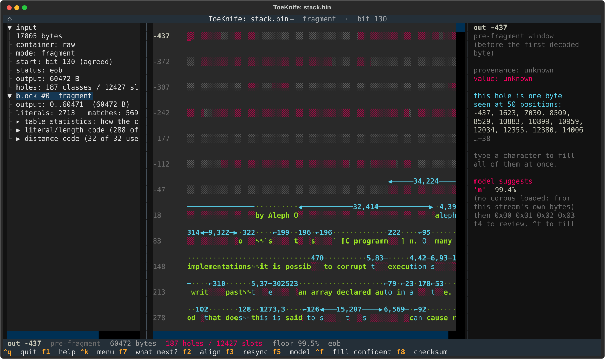
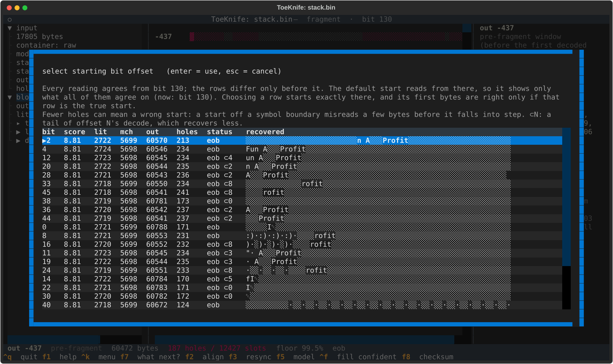
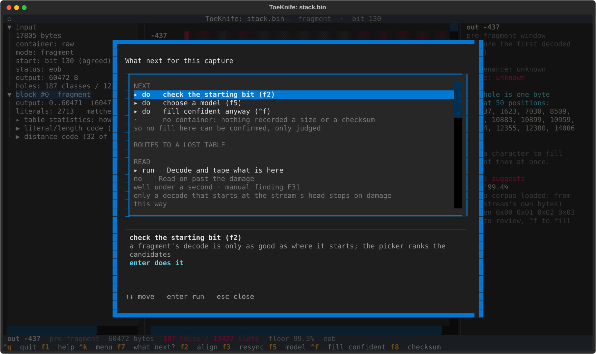
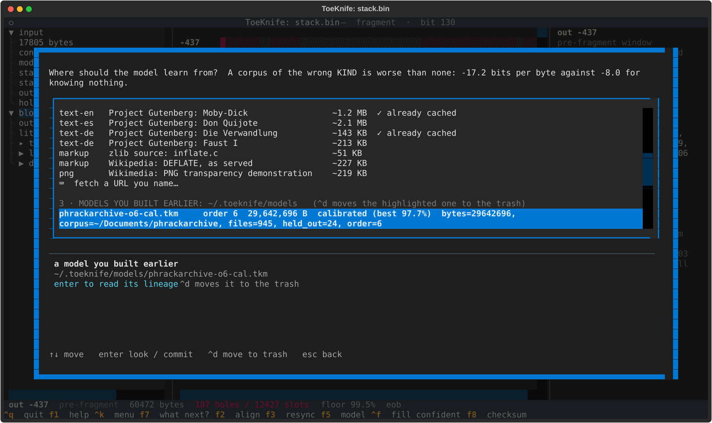
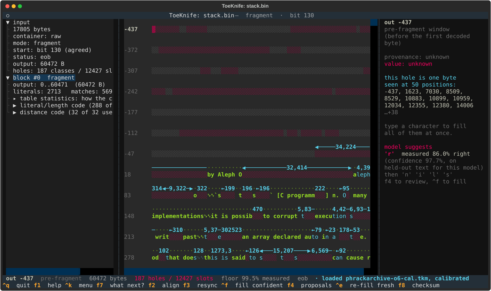
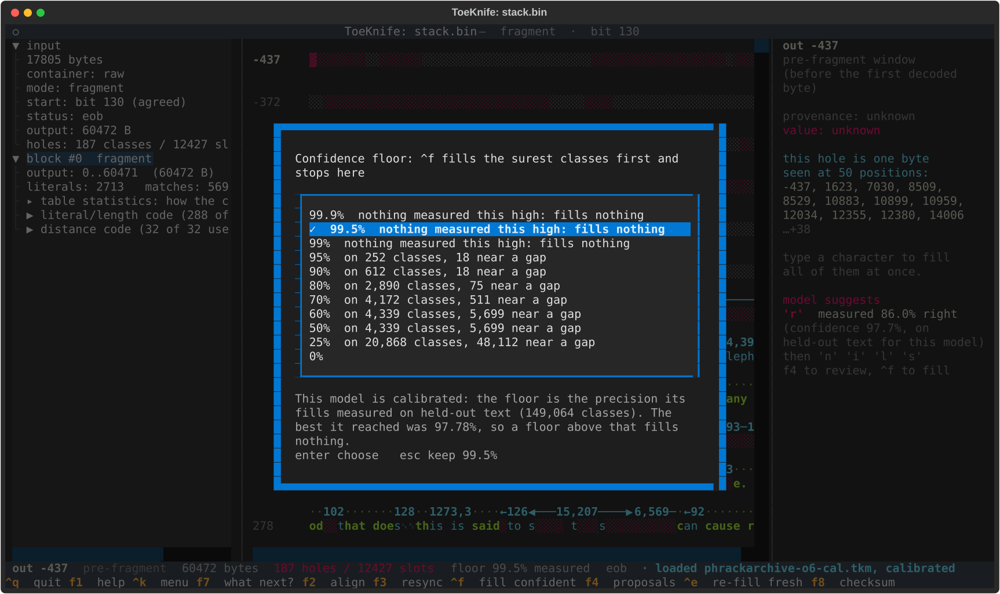
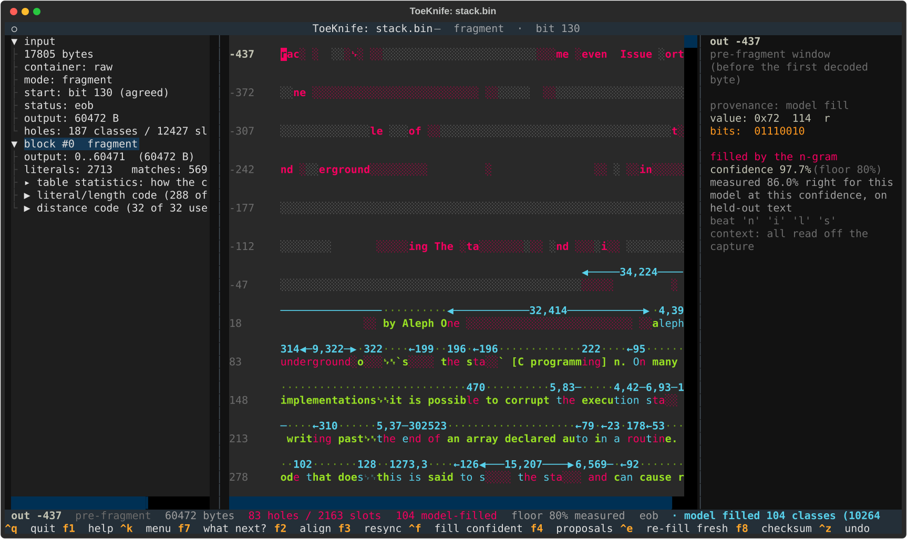
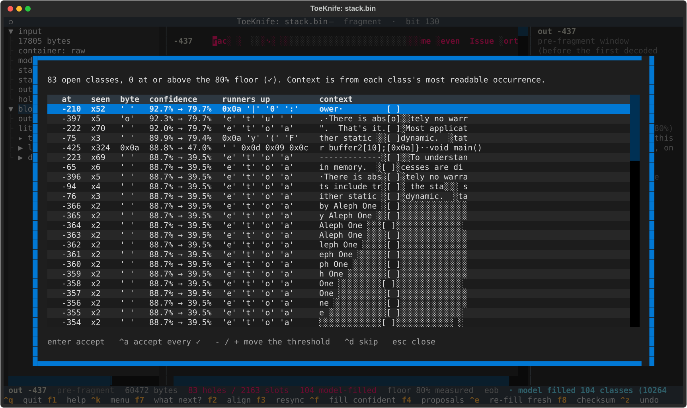
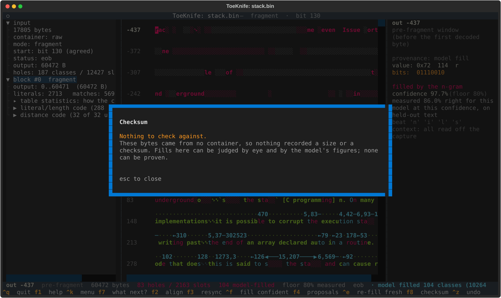

# A. Carved fragment

We have the tail of a DEFLATE stream: carved off a disk, cut out of memory,
whatever survived after the start was lost. No header, no table, no container.
We'll decode it, load a model trained on similar text, fill what the model can
fill at a precision we choose, and check each fill.

The specimen is `stack.bin`: Phrack 49 file 14, "Smashing the Stack for Fun and
Profit" by Aleph One, compressed with the fixed Huffman table, with the first
100 or so bytes cut off.

## Make a specimen

Any text works:

```
python3 -c "
import zlib, sys
co = zlib.compressobj(9, zlib.DEFLATED, -15, 9, zlib.Z_FIXED)
sys.stdout.buffer.write(co.compress(open(sys.argv[1], 'rb').read()) + co.flush())
" article.txt > article.deflate
tail -c +101 article.deflate > chopped.bin
```

The first command deflates `article.txt` raw with the fixed table; `tail`
drops the first 100 bytes. Done to the Phrack article it leaves 181 unknown
classes. The fixed table matters: a stream with a dynamic table loses the table
with its first bytes, and that is [Workflow E](e-lost-table.md).

## 1. Open it

From the directory holding the specimen:

```
toeknife stack.bin
```



The left pane:

```
mode: fragment
start: bit 130 (agreed)
output: 60472 B
holes: 187 classes / 12427 slots
```

The tape opens at position -437, in the window: the text the missing start
would have produced. It is mostly red. Further down the article reads in green
and cyan, with red `░` wherever a copy reaches back into the window.

## 2. Check where it starts

A fragment starts mid-byte and nothing marks where its first whole symbol
begins. ToeKnife decodes from every candidate bit. The readings disagree for
a few symbols, then fall into step; on this file all of them agree from bit 130
on, and the decode starts there. `f2` shows the candidates:



One row per starting bit: output length (`out`), unknown classes (`holes`),
whether it reached a clean end of block (`status: eob`), and a preview. `⊂4`
marks a tail of the row for bit 4, which recovers less.

Keep the default unless you know the true start. The rows differ only before
bit 130, and fewer holes can mean a worse start: bit 0 shows 171 holes against
bit 2's 213, and checked against the real article it misreads 6 bytes. Choose
a row and the decode starts exactly there; if that is before bit 130, the
status line warns that the first bytes depend on your choice. `escape` keeps
the default.

## 3. Ask what next



`f7` lists the steps for this file: check the start (done), choose a model,
fill. It also says there is no container here, so nothing recorded a size or a
checksum.

## 4. Load a model

`f5` lists where a model can come from. The last section holds the ones already
built:



`phrackarchive-o6-cal.tkm` is an order-6 n-gram trained on 945 Phrack articles,
with 24 more held back to test it. `calibrated (best 97.7%)`: on those 24, its
surest fills were right 97.7% of the time. [Models](models.md) covers training
one.

Highlight it, `enter` to read its lineage, `enter` again to load:



The status line reads `loaded phrackarchive-o6-cal.tkm, calibrated (best
97.7%)`. The side pane's suggestion for the byte under the cursor now carries a
figure: `measured 86.0% right`, how often this model was right at that confidence
on the held-back articles.

## 5. Set the floor

`^f` fills only what clears the floor, and with this model the floor is a
measured precision. The default, 99.5%, fills nothing here: no confidence level
was right that often on the held-back text. `^k`, type `threshold`, `enter`:



Each row says how many held-out holes that floor was measured on, and how
many of them sat beside a lost packet. Choose 80%. At 90% this model fills
21 classes here: of the 21,975 short holes it was tested on, the surest 612
measured 90% right or better, and the next step down measured 87.9%.

## 6. Fill

`^f` fills the surest 32 classes, re-scores their neighbours, and repeats until
nothing left clears the floor. A progress screen shows the run as a whole and
one bar per round.


10 rounds, 11 seconds, 104 of the 187 classes filled. Checked against
the real article afterwards:

| | right |
|---|---|
| classes filled | 101 of 104 (97.1%) |
| output positions they cover | 10,246 of 10,264 (99.8%) |

The positions score higher because the large, much-repeated classes are the
easy ones. Every one of these fills measured 80% or better on the held-back
articles; this article did better than that. The status line now shows `83
holes` and `104 model-filled`, and the window at the top reads in magenta.

## 7. Check a fill

Put the cursor on a magenta byte:



The right pane lists who filled it (`the n-gram`), its confidence and the floor
at the time, the measured figure for that confidence (86.0%), the bytes it beat,
and how much of its context came from the capture (`all read off the
capture`). A fill made deep inside a long unknown run is flagged in yellow.

Wrong? Type the right character over it. Your byte replaces the model's, turns
yellow, and counts as evidence for every class near it. Then `^e`: it takes
back the model's fills and runs them again with your corrections in place. On
a phrack carve with 200 typed classes, refilling on top of the mistakes left
754 wrong bytes; `^e` first left 76.

`^z` undoes a whole `^f` run.

## 8. What's left

`f4` lists every open class with the model's guess, its runners-up, and the
text around the class's most readable occurrence:



The confidence column gives the raw score and, after the arrow, its measured
precision: `92.7% → 79.7%`. None of the 83 remaining classes measured 80%;
the best measured 79.7%. `enter` takes the highlighted guess anyway, `^a` takes every row marked
✓, and `-` / `+` move the floor while you watch the marks change.

## 9. The checksum



A carve has no container, so `f8` has nothing to compare against and the fills
stay magenta. If the fragment came out of a gzip or zip you also have, open
that file instead and `f8` can check the result.

## 10. Keep the result

- `^w` writes the recovered bytes to a file, window first, `?` for each
  unknown byte.
- `^s` saves the session: start bit, your bytes and the model's fills. See
  [Sessions](sessions.md).
