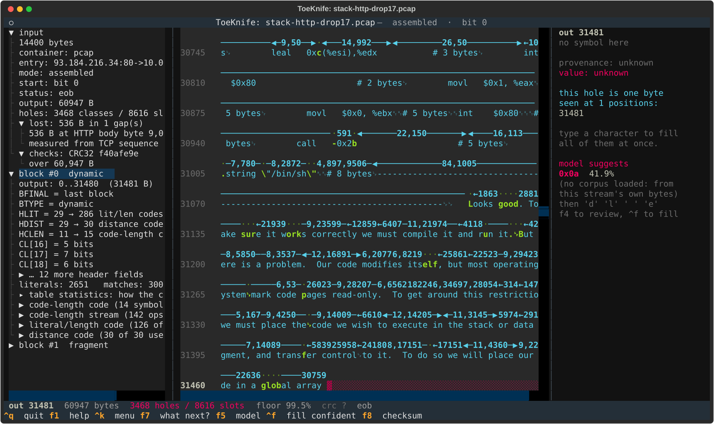
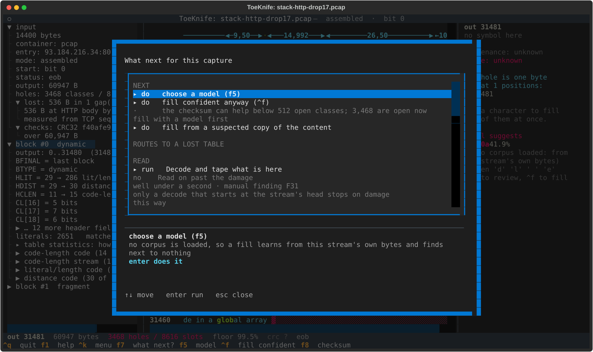
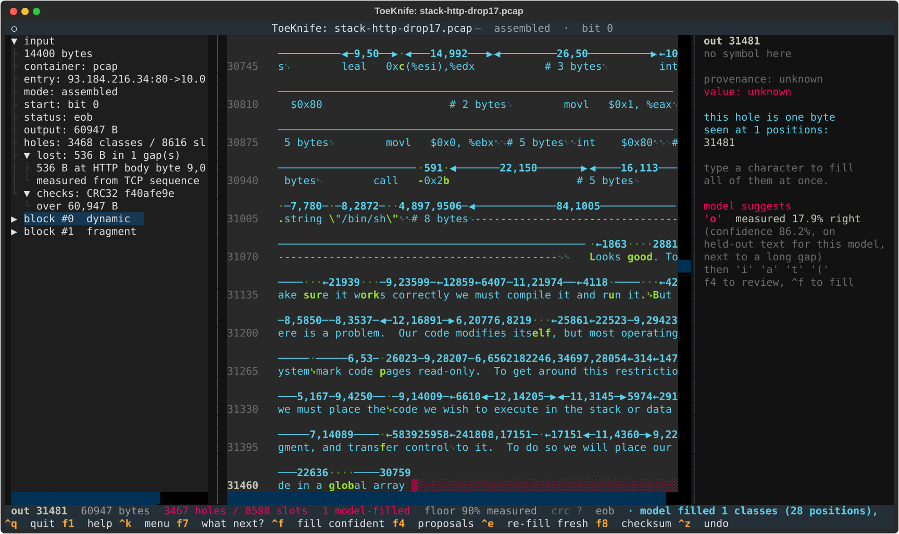
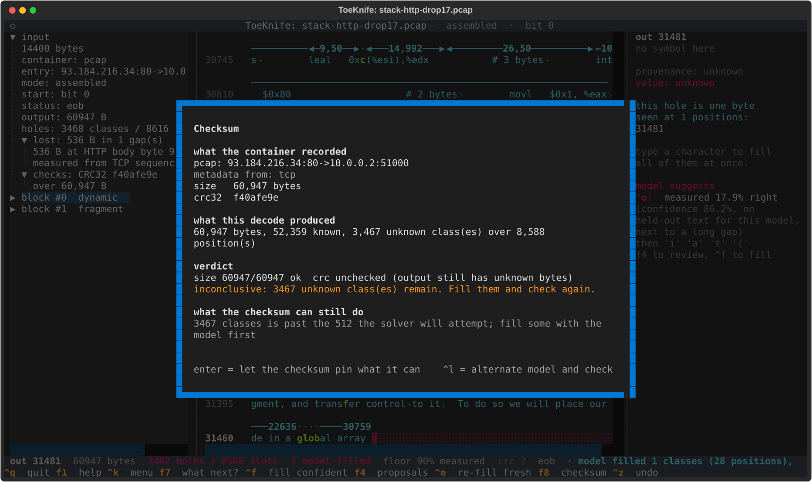
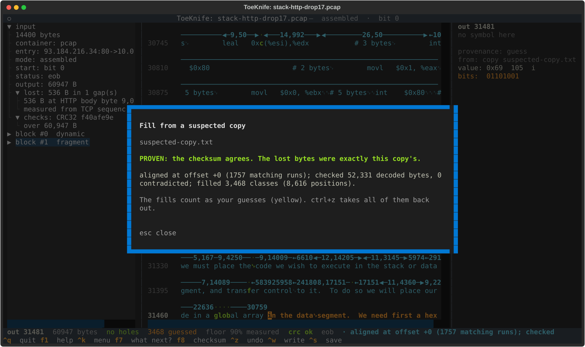
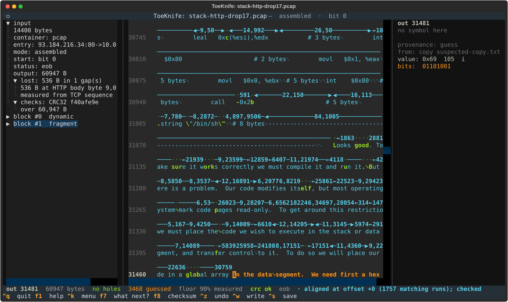
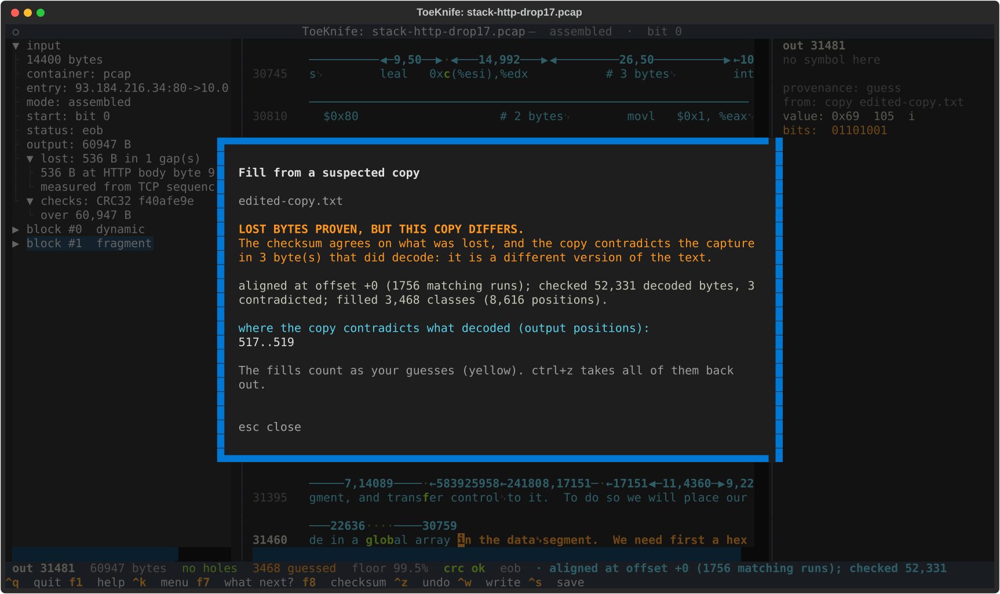

# B. Lost packet

We have a capture of a gzip'd HTTP response with one packet missing. ToeKnife
finds exactly what was lost, shows that no model can fill it, and then checks a
suspected copy of the content against the gzip trailer's CRC, down to the
byte.

If you know or suspect what the content was (the page fetched again later, a
cached copy, the public document), this is how you prove it. If you have no
candidate, the capture still tells you precisely what is gone.

The specimen is `stack-http-drop17.pcap`: the Phrack article from
[Workflow A](a-carved-fragment.md), served gzip'd in 536-byte TCP segments,
segment 17 of 29 deleted.

## Make a specimen

From a real capture, `editcap` deletes a packet. Write classic pcap: ToeKnife
reads classic pcap with Ethernet, IPv4 and TCP, and turns pcapng away by name.

```
editcap -F pcap capture.pcapng lossy.pcap 117
```

That drops packet 117. Choose one in the middle of the response, so the gzip
header and the trailer both survive; the trailer is what proves a fill.

From any text, `docs/manual/specimens.py` builds one, along with the
specimens for [C](c-damaged-zip.md) and [D](d-bit-rot.md):

```
python3 docs/manual/specimens.py p49-14.txt
```

It writes `stack-http.pcap` (every packet), `stack-http-drop17.pcap` (536-byte
segments, segment 17 left out) and `edited-copy.txt` (the text with `One`
changed to `Two` at byte 517). The article itself is the suspected copy:
`cp p49-14.txt suspected-copy.txt`.

## 1. Open it

```
toeknife stack-http-drop17.pcap
```



ToeKnife reassembles the TCP stream, strips the HTTP head, and opens at the
first hole. The left pane:

```
lost: 536 B in 1 gap(s)
  536 B at HTTP body byte 9,001
  measured from TCP sequence numbers
checks: CRC32 f40afe9e
  over 60,947 B
```

TCP numbers every byte, so the gap's position and width come straight from the
sequence numbers of the segments on either side. The gzip trailer survived, so
there is a CRC to check against.

The text decodes cleanly up to output 31,481, then goes red: those 536
compressed bytes held 3,468 bytes of article. The status line says `3468 holes
/ 8616 slots`: the lost bytes, plus every later copy that reaches back into
them.

## 2. Ask what next



`f7` offers a model, a fill, and "fill from a suspected copy of the content".
The checksum line explains why `f8` can't help yet: CRC32 solves for missing
bytes when fewer than 512 classes are open, and 3,468 are.

## 3. A model can't fill it

A model fills a byte from the bytes around it. In the middle of a 3,468-byte
gap there are none, and each guess becomes context for the next one. Fills
there were right 19% of the time on test captures, whatever the floor, so `^f`
holds them back. Lower the floor far enough to reach them and `^f` stops and
asks first.

The classes just after the gap are the other trap: they are copies in the
surviving text that point back into it. A calibrated model measures them on
their own curve, with test captures cut the same way, and that curve sits well
below the carve figures. Load the Phrack model from
[Workflow A](a-carved-fragment.md) and run `^f` at a 90% floor:



One class clears 90%. Checked against the real article, it is wrong. At a 70%
floor it fills 8, of which 4 are right, and at 50% it fills 52, of which 28
are right. Treat anything filled here as a lead to check by eye; `^z` takes
the run back out.

`f8` has nothing to rule on with 3,468 classes open:



## 4. Fill from a suspected copy

`^k`, type `suspected`, `enter`, and give it the candidate's path:



ToeKnife finds where the copy lines up with the decoded bytes (an extra header
or a shifted start is fine), checks all 52,331 decoded bytes against it, fills
the 3,468 open classes from it, and computes the CRC. It matches. The lost
packet held exactly these bytes.

The fills are yellow: they count as your guesses, since you chose the file. The
status line reads `no holes`, `3468 guessed`, `crc ok`.



The side pane names where the byte under the cursor came from:
`from: copy suspected-copy.txt`.

## 5. When the copy is wrong

There are three ways for a candidate to fail, and the screen tells them apart.

**It contradicts the capture.** This copy has one word changed in text that
survived:



The lost bytes still match, so the CRC agrees. But 3 decoded bytes, output
517 to 519, disagree with the copy. The verdict says both: lost bytes proven,
and the copy is a different version of the text.

**It contradicts itself.** Two positions the capture proves equal hold
different bytes in the copy. That rules it out before the CRC runs.

**It differs inside the lost bytes only.** Nothing decoded can catch this. The
CRC does, and the screen says the difference lies in the lost part.

A file that shares nothing with the decoded text is turned away, and nothing is
filled from it.

## 6. Keep the result

`^w` writes the recovered body. `^s` saves the session with the copy's bytes as
your guesses; the ledger records the file they came from and the CRC verdict.
See [Sessions and evidence](sessions.md).

The same check from the command line:

```
toeknife stack-http-drop17.pcap --fill-from suspected-copy.txt --verify
```
