# C. Damaged zip

We have a zip that won't extract cleanly. ToeKnife opens each entry, decodes
it, and checks it against the CRC32 and size the archive recorded. Intact
entries verify. Damaged ones fail, and a copy of the original shows exactly
which bytes are wrong.

The specimen is `stack.zip`, five entries built from the Phrack article in
[Workflow A](a-carved-fragment.md):

| Entry | Damage |
|---|---|
| `intact.txt` | none |
| `rotted.txt` | one flipped bit in the compressed data |
| `shredded.txt` | 200 bytes overwritten halfway through the compressed data |
| `stored.bin` | none; stored uncompressed |
| `secret.txt` | none; encrypted with the password `forensics` |

## Make a specimen

`docs/manual/specimens.py` builds it from any text:

```
python3 docs/manual/specimens.py p49-14.txt
```

It writes `stack.zip`, `stack-noeocd.zip` and `stack-sfx.zip`, and the B and
D specimens with them. For `rotted.txt` it searches for one bit whose flip
still leaves every Huffman code legal, so the entry decodes without
complaint; on the Phrack article that is compressed byte 5,018, bit 0. For
`shredded.txt` it overwrites 200 bytes starting halfway in.

## 1. Open it

```
toeknife stack.zip
```

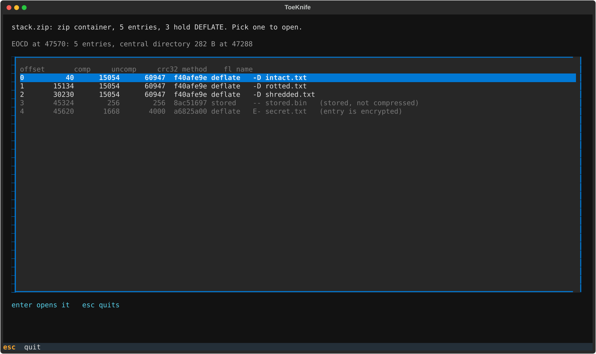

An archive with more than one DEFLATE entry opens on a list of them. The line
above the list is what ToeKnife found in the archive's structure: the
end-of-central-directory record at byte 47,570, describing 5 entries. Entries
that can't be decoded are greyed, with the reason: `stored.bin` is `stored,
not compressed`, and `secret.txt` is `entry is encrypted`.

`enter` opens the highlighted entry. To skip the list, name the entry:
`toeknife stack.zip --entry rotted`. With an output flag such as `--verify`,
or with no terminal, ToeKnife prints the table and exits.

## 2. The intact entry

Open `intact.txt` and press `f8`:

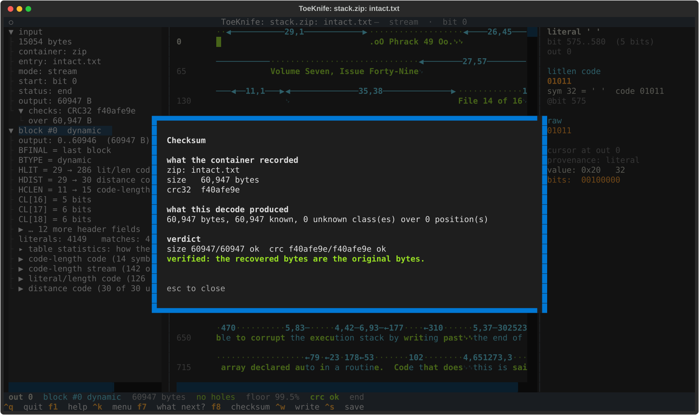

The archive recorded 60,947 bytes with CRC32 `f40afe9e`, and the decode
matches both. Those bytes are the original.

## 3. A flipped bit

Open `rotted.txt`:

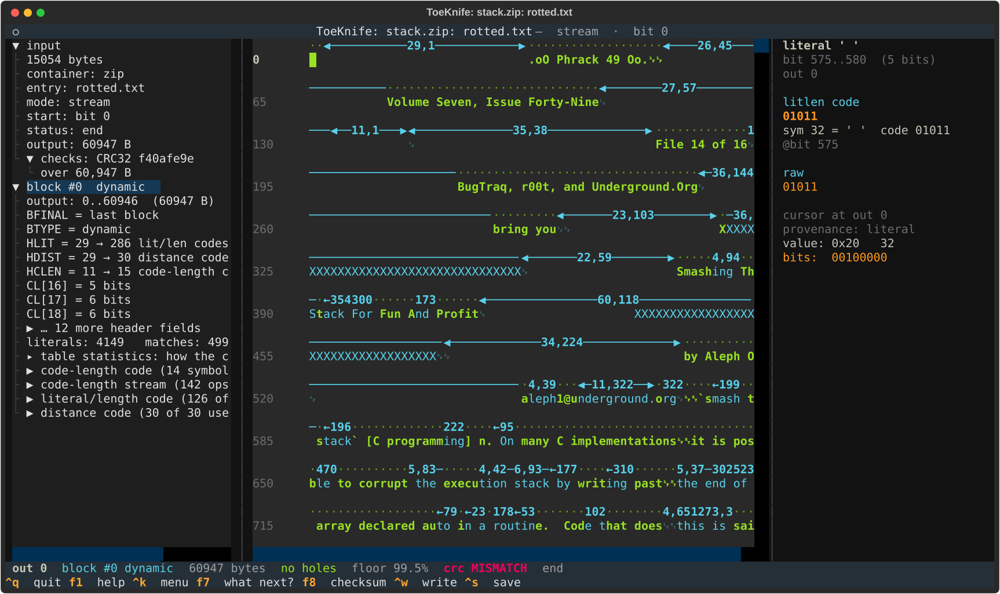

It looks perfect. All green, `no holes`, 60,947 bytes, the article reads
cleanly. The status line also says `crc MISMATCH`. `f8` has the detail:

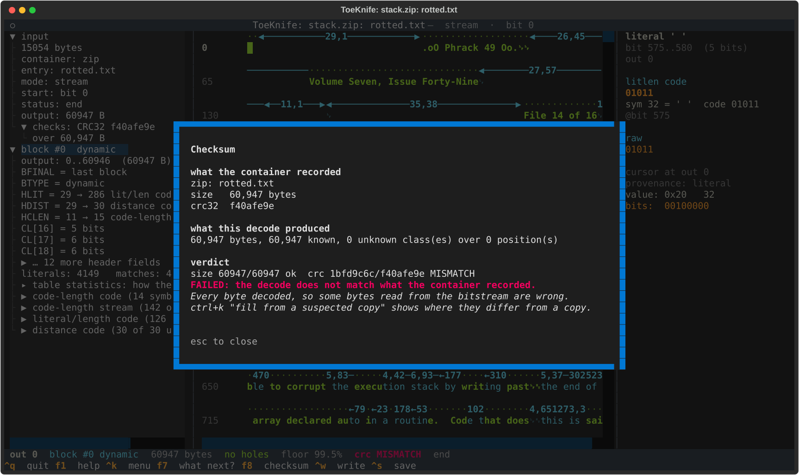

Size right, CRC wrong. The flipped bit changed what two symbols meant, and both
still decoded to legal bytes, so nothing in the decode itself looks wrong. The
CRC is the only thing that notices.

`f7` says what can be done:

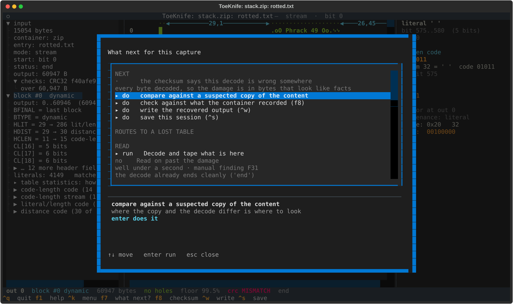

With every byte decoded and the checksum disagreeing, the damage is somewhere
in bytes that look like facts. A copy of the original can point at it. `^k`,
`suspected`, and give it the copy:

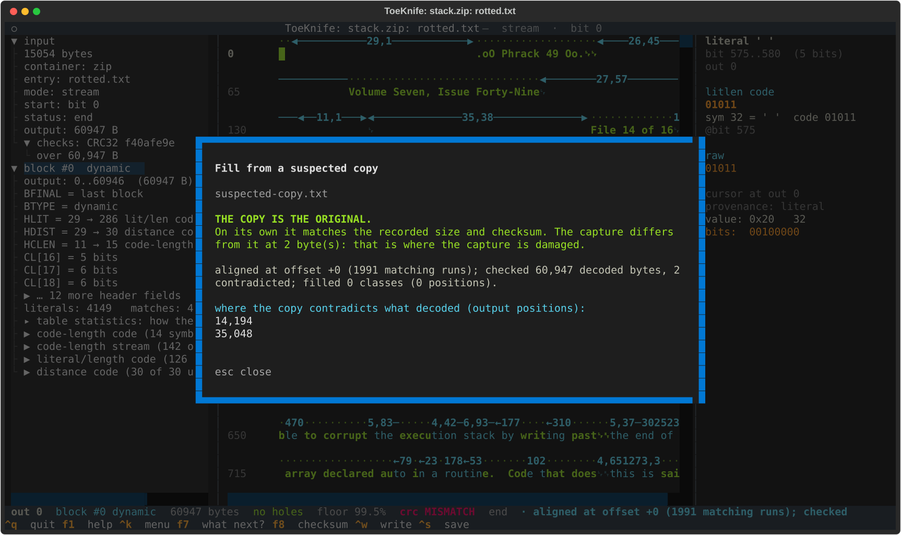

`THE COPY IS THE ORIGINAL`. ToeKnife checks the copy by itself against the
archive's record: 60,947 bytes, CRC32 `f40afe9e`, both match. So the copy is
the original, and the two bytes where it differs from the decode, output
14,194 and 35,048, are the two the flipped bit damaged.

## 4. A burst of garbage

Open `shredded.txt`:

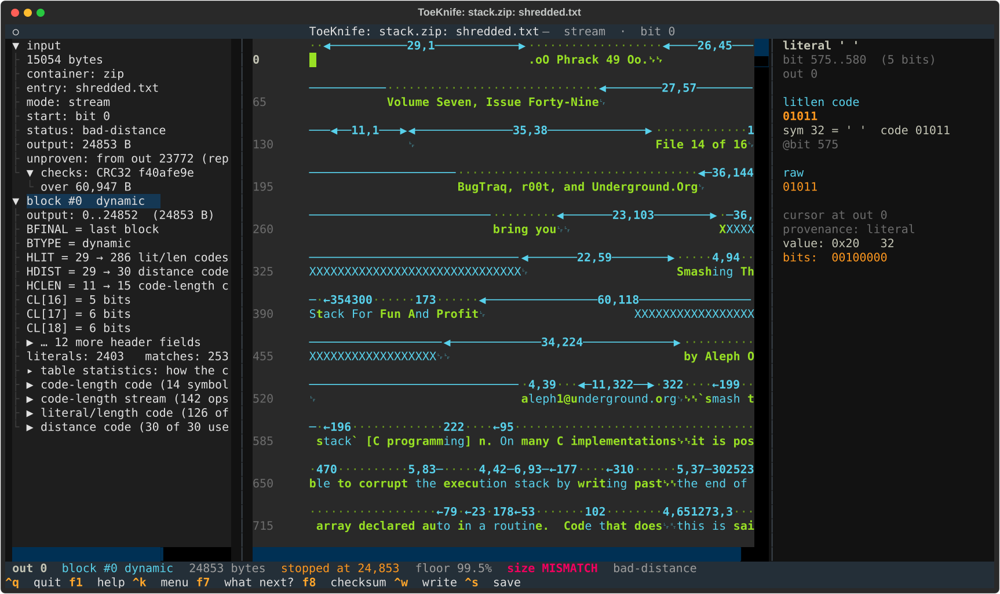

The left pane says `status: bad-distance` and `output: 24853 B`; the status
line says `stopped at 24,853` and `size MISMATCH`. The decode ran until the
garbage produced a back-reference to before the start of the output, which is
impossible, and stopped there. `f8`:

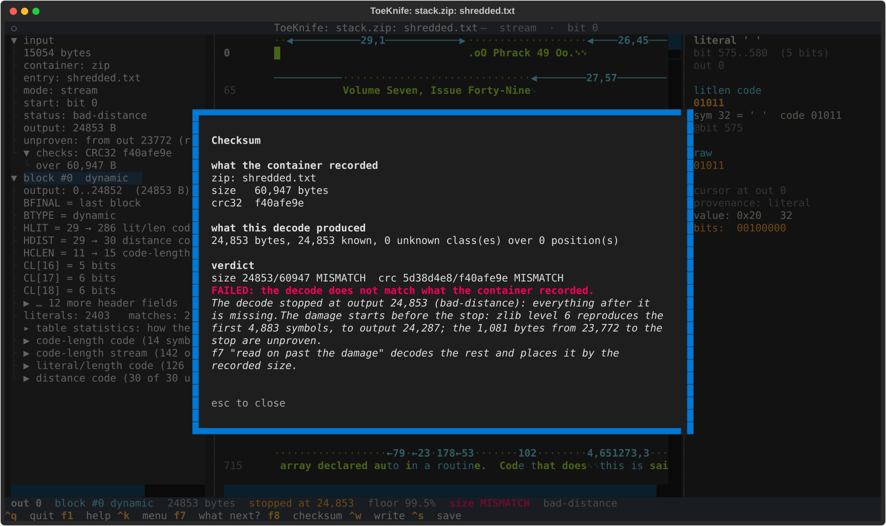

Everything after output 24,853 is missing, and some of the bytes before it
are garbage: the decoder read the burst as symbols for a while before one of
them was invalid. Nothing in the bits marks where that started. The encoder
does. zlib's parse depends only on the input bytes and the level, so ToeKnife
compresses the decoded output again at levels 1 to 9 and compares the
symbols with the captured ones. Level 6 reproduces the first 4,883 symbols,
up to output 24,287, and then disagrees. The damage starts close to there.

The cut goes 512 bytes earlier, at output 23,772, and the 1,081 bytes from
there to the stop are blue: unproven. The left pane says `unproven: from out
23772 (replay)`. On this entry the garbage really starts at 24,245, so all
574 wrong bytes are inside the blue run.

The 512 is measured, over 560 bursts in files made by
Python's zlib, GNU gzip, pigz, busybox gzip, Info-ZIP, libdeflate and 7-Zip.
The replay never diverged more than 209 bytes after the real start, and no
burst left a wrong byte in green or cyan. libdeflate and 7-Zip parse
differently and the replay can't follow them. For those, everything from the
start of the block before the last real-looking one is blue. It's safe and
expensive: a median of 20,542 good bytes go blue on libdeflate files and
23,418 on 7-Zip ones. Damage in a block's header gets the whole block;
[D](d-bit-rot.md) shows why.

The compressed data past the burst is intact, and so are the 36,094 bytes it
holds. `f7`:

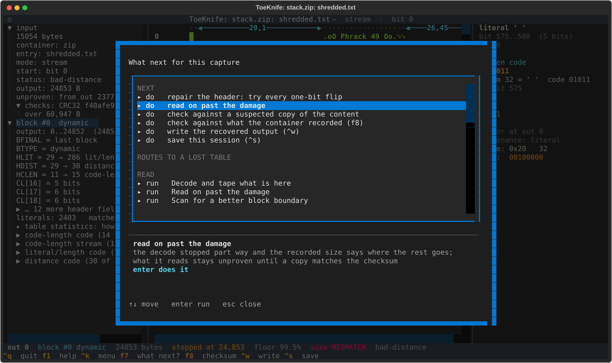

`read on past the damage` starts decoding where the decode stopped, with the
same table. DEFLATE resynchronises by itself: the first symbols read from
garbage, then the reading lands on real symbol boundaries and stays on them,
here all the way to the final end-of-block at the end of the entry. The
archive recorded 60,947 bytes, so the last byte read goes at output 60,946 and
everything before it falls into place counting back from there. Press `enter`:

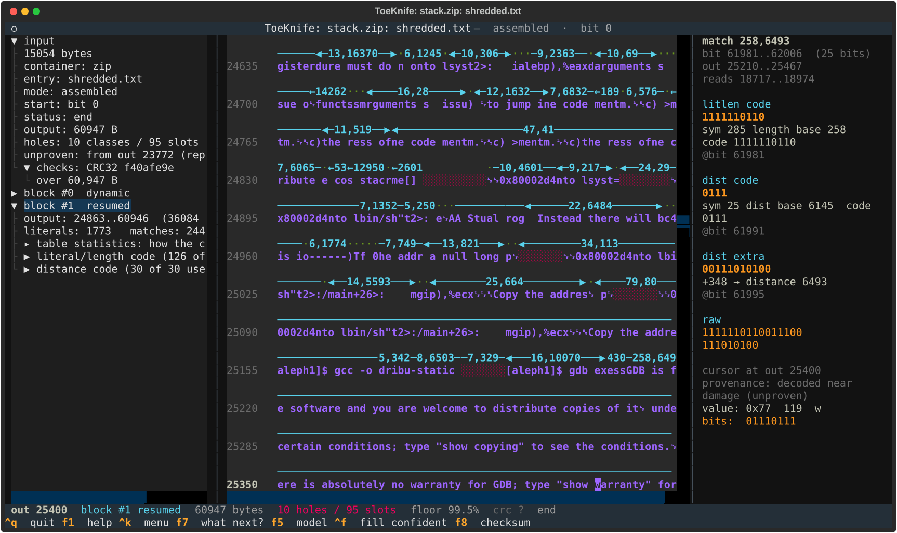

The status line says `read on from bit 61,040: 36,084 bytes placed by the
recorded size, 10 unknown between`. 211 more bytes came out of the reading;
they would have overrun the recorded size or copied from before output 0,
which no real symbol does, so they are dropped. The left pane shows the new
`block #1 resumed`, output 24,863 to 60,946.

The new bytes are blue too, the inspector says `decoded near damage
(unproven)`, and you can't type over them. Nothing in the data says where the burst ends:
the readings agree with each other well before it does, and a byte model
scores the garbage about as well as the text. Back-references then copy the
garbage forward. On this entry 3,205 of the 35,999 blue bytes are wrong, the
last at output 60,836. The screenshot shows both: `0x80002d4nto lbin/sh` at the
seam is garbage, and `[aleph1]$ gcc -o` a few rows down is the article.

`f8` says the same thing:

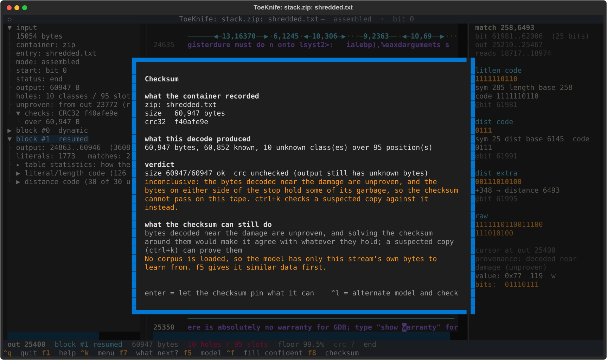

The size matches, the CRC can't pass with garbage on the tape, and the
checksum solver refuses to fill the 10 open classes. Solving the CRC around
wrong bytes would make it agree with them, and the result would read as a
pass.

The copy settles it. `^k`, `suspected`, and give it the copy:

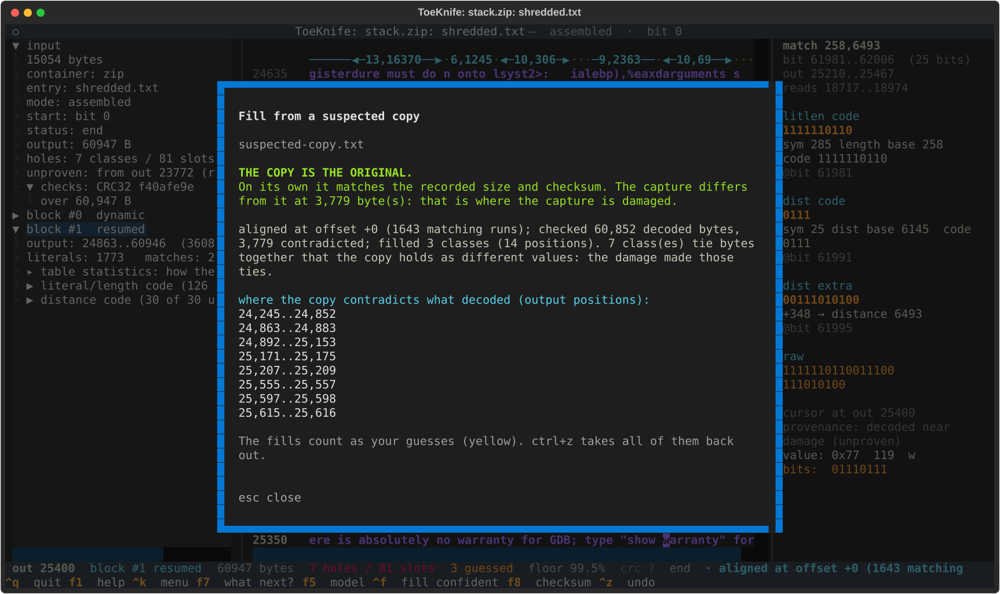

`THE COPY IS THE ORIGINAL`: by itself it matches the recorded size and CRC32.
It differs from the decode at 3,779 bytes, and the list says where: 24,245 to
24,852 is the garbage the decoder read before it stopped, and everything from
24,863 on is garbage read past the stop or copied from it. Every other byte of
the decode, 57,073 of them, agrees with the original.

## 5. A truncated archive

Truncation takes the central directory first: it sits at the end of the file.
`stack-noeocd.zip` is `stack.zip` with the directory and the end record cut
off:

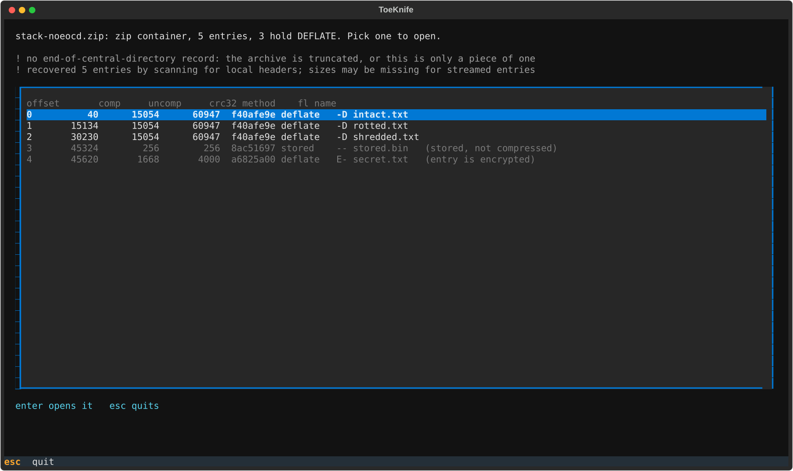

ToeKnife says the end record is missing and recovers all 5 entries by scanning
for local headers. Each local header carries its own copy of the CRC, so every
entry is checked as before: `intact.txt` verifies, and the two damaged entries
fail. A zip written in streaming mode leaves sizes out of its local headers,
which is what the second warning is about.

## 6. Junk in front

`stack-sfx.zip` has 4,096 bytes glued to the front, the way a self-extracting
archive carries its extractor:

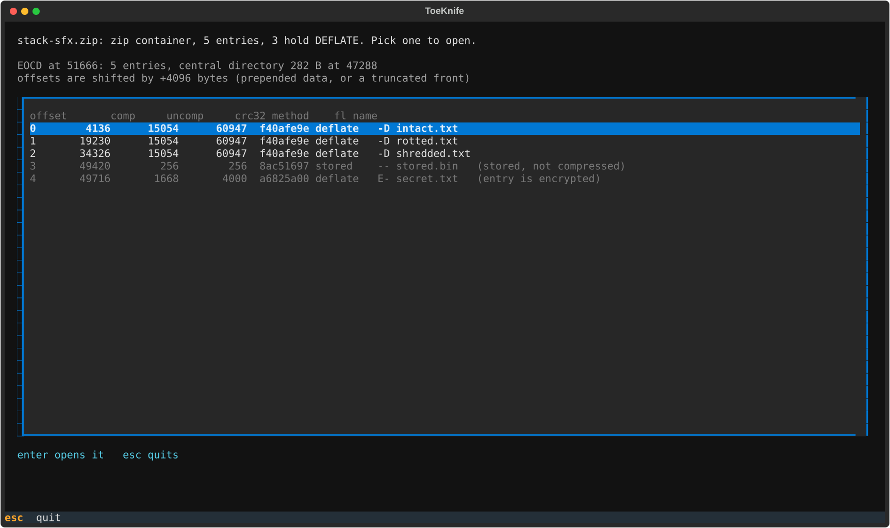

Every offset the directory records is now 4,096 bytes short. The end record
says how large the directory is and where it should start; the difference
between that and where it really is gives the shift. The picker shows
`offsets are shifted by +4096 bytes`, and every entry opens and verifies at
its corrected offset.

## 7. From the command line

```
toeknife stack.zip                               # the entry table
toeknife stack.zip --entry rotted --verify       # one entry's verdict
toeknife stack.zip --entry rotted --fill-from original.txt --verify
toeknife stack.zip --entry shredded --resume --fill-from original.txt
toeknife stack.zip --entry intact --export intact.txt
```

`--verify` exits 0 when the entry verifies, 1 when it fails, and 2 when there
is nothing to check against.
