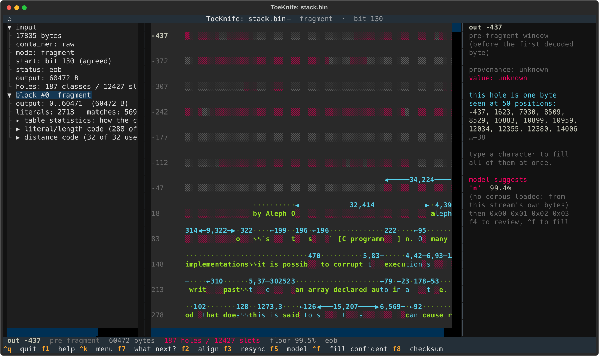

# Concepts

Five ideas run through every workflow. Read this page once.

## Three kinds of damage

**Missing bytes.** Part of the stream is gone: the start of a carve, a lost
packet, a bad sector. What survives still decodes. Anything it copies from the
missing part comes out unknown.

**Flipped bits.** Every byte is there and a few bits are wrong. The decode
usually goes off the rails at the first bad bit. [Workflow D](d-bit-rot.md)
repairs the common case, a damaged header.

**A missing table.** A dynamic DEFLATE block opens with the Huffman table that
says what its bits mean. Lose the table and the block is unreadable, every bit
of it present. [Workflow E](e-lost-table.md) covers the ways back.

## Holes and classes

DEFLATE compresses by copying: "repeat the 12 bytes from 340 bytes back". If
the source of a copy is unknown, so is the copy, and the two are known to be
equal. ToeKnife groups unknown positions that the stream proves equal into
**classes**.

The status line counts both. `187 holes / 12427 slots` means 187 unknown
classes covering 12,427 output positions. Fill a class and every position in it
fills at once, which is why one keystroke can light up a dozen places.

## Colours

Each byte on the tape is drawn in the colour of how it is known:

| Colour | Means |
|---|---|
| Green | read from the bitstream |
| Cyan | copied from a byte already known |
| Yellow | you typed it, or it follows from something you typed |
| Magenta | a model filled it |
| Red `░` | unknown, fillable |
| Grey `░` | window space nothing in the stream refers to |

Green and cyan are facts. Yellow and magenta are guesses: yours and the
model's.

## The screen

- **Left:** the input, what the container says about it, and its blocks.
  Select a block to jump to its first byte.
- **Middle:** the tape. Text is the decoded output; the lines above it are
  back-references, labelled `length,distance`. The numbers down the left are
  output positions. Negative ones are the window before the first decoded byte.
- **Right:** the byte under the cursor: its bits, how it is known, and for an
  unknown one, the model's suggestion with its figure.
- **Status line:** cursor, size, holes and slots, model-filled count, the
  floor, and the checksum verdict when there is one.
- **Footer:** the keys for where you are. With no model loaded it offers
  `f5 model`; while filling, `f4 proposals` and `^e re-fill`; with nothing
  open, `^w write` and `^s save`.

A printable key fills the hole under the cursor with that character. Commands
live on `ctrl` and the function keys. `^k` is a searchable menu of every
command. `f7` suggests what to do next for the file in front of you. `f1` is
the key reference.

## What proves a fill

A model's fill is a guess with a figure attached. Two things can prove one:

- **The container's checksum.** gzip and zip store a CRC32 of the original,
  zlib an Adler-32, and a gzip'd HTTP body in a capture carries the gzip
  trailer. With every class filled, `f8` computes the checksum and compares.
  CRC32 is linear, so with under 512 classes open `f8` can also solve for them
  outright.
- **A copy of the content.** Lay a candidate file over the capture and every
  decoded byte tests it, then the checksum rules on the rest
  ([Workflow B](b-lost-packet.md)).

A bare fragment has neither. Its fills can be checked by eye and by their
figures, and `f8` says there is nothing to compare against.

## The confidence floor

`^f` fills the classes the model is surest of, best first, and stops at the
**floor** on the status line: `floor 90% measured`. `^k` → "set the confidence
threshold" changes it.

The floor is a precision. Every n-gram ToeKnife trains holds part of its corpus
back and is tested on it, so a floor of 90% fills only what this model got
right at least 90% of the time on text it never saw. A byte model carries the
same kind of curve when its file has one; `f5` marks which do. Short holes in decoded
text, holes beside a lost packet and holes deep inside one are measured
separately; they behave differently. The side pane and `f4` quote the same
figures. [Models](models.md#how-accurate-are-the-fills) explains where they
come from.

Deep inside a long run of unknown bytes, fills were right 19% of the time at
any floor. `^f` stops before filling there and asks.
