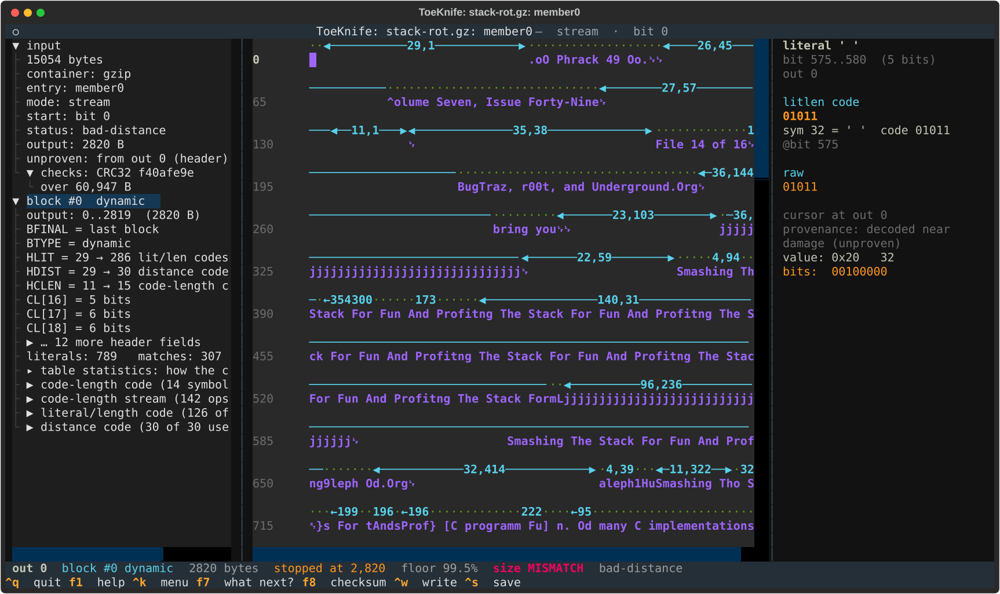
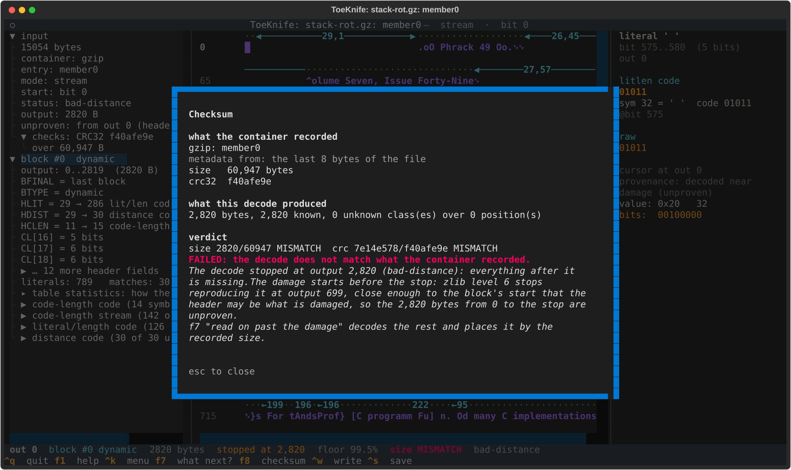
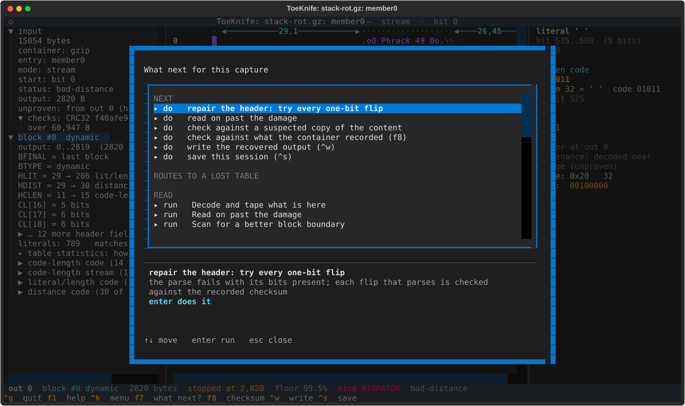
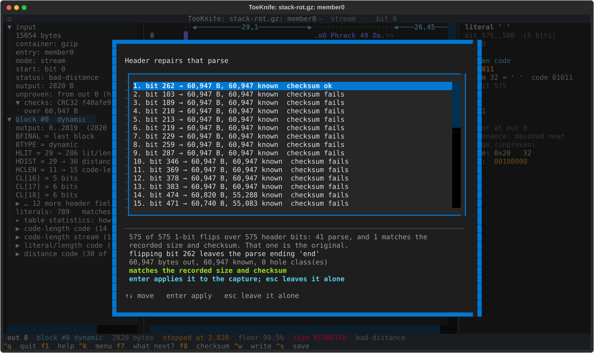
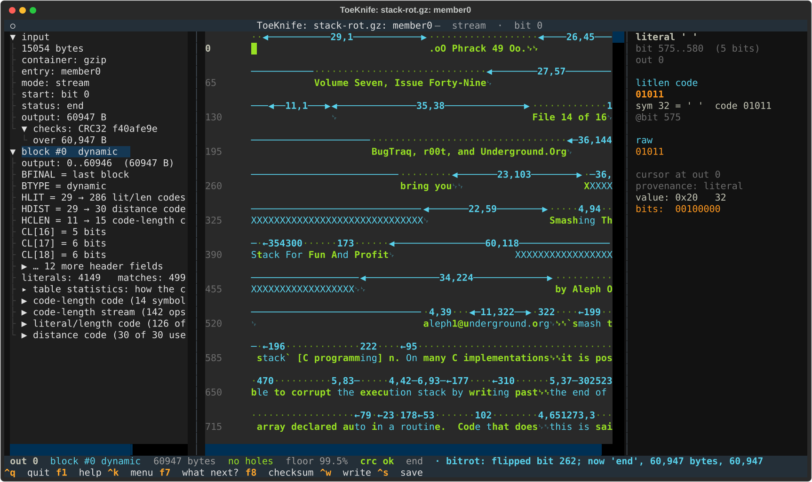
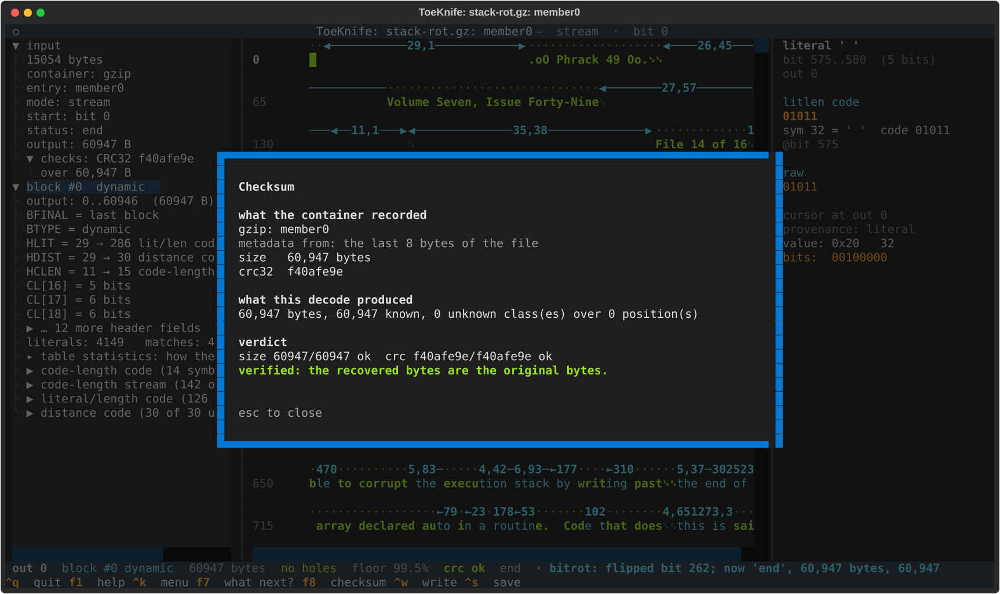

# D. Bit rot

We have a gzip file with one bit wrong in a block header. Every bit is still
there; one of them is inverted, and the Huffman table it describes is wrong,
so the whole block decodes to garbage or not at all. ToeKnife tries every
one-bit flip over the header, keeps the ones that parse, and holds each
against the CRC32 and size the gzip trailer recorded. The one that matches is
the original.

The specimen is `stack-rot.gz`: the Phrack article from
[Workflow A](a-carved-fragment.md) gzipped, with bit 262 of the compressed
data inverted (byte 32, bit 6; byte 42 of the file). `gzip -t` says
`invalid compressed data--format violated`.

## Make a specimen

```
python3 docs/manual/specimens.py p49-14.txt
```

That writes `stack-rot.gz` with the B and C specimens. Bit 262 is in the code
lengths of the literal/length table. Any header bit will do for practice:
most flips there break the decode, and `rotted_gzip(art, bit)` in the script
takes the bit as an argument.

## 1. Open it

```
toeknife stack-rot.gz
```



The left pane says `status: bad-distance` and `output: 2820 B`. The table
decoded, but it is the wrong table: `^olume Seven` where the article says
`Volume Seven`, `BugTraz` for `BugTraq`, runs of `jjjj`, and after 2,820
bytes a back-reference that reaches before the start of the output, which
stops the decode.

All of it is blue, and the left pane says `unproven: from out 0 (header)`.
ToeKnife compresses the decoded bytes again with zlib and compares the
symbols with the captured ones. A burst in the middle of a block shows up
where the two stop agreeing. A wrong table garbles the block
from its first symbol, and the garbled output recompresses into the same
garbled symbols for a while; here they agree up to output 699. That is too
close to the block's start to rule out the header, so the whole block is
unproven. ([C](c-damaged-zip.md), section 4, has the burst case.)

`f8`:



`size 2820/60947 MISMATCH` and the CRC fails. The gzip trailer still holds
the right figures, `60,947 bytes` and `f40afe9e`, and those are what will
choose the repair.

## 2. Repair the header

`f7`:



The first row under NEXT is `repair the header: try every one-bit flip`.
`enter`:



The header is the 575 bits between the block's first bit and its first
symbol. ToeKnife flips each one, decodes the whole block, and keeps the flips
that land cleanly on the final end-of-block: 41 of them. Each one has a
different table and produces different text, and 13 of them produce exactly
60,947 bytes, so the size alone can't choose. The CRC can. Bit 262 is the
only flip whose output matches both, and it is listed first with `checksum
ok`; the other 40 say `checksum fails`.

On the same article, 82 one-bit flips that broke the header left more than
one survivor 63 times, up to 54 of them. Ordered by output alone, the true
repair was not first in 26 of the 82. The CRC passed exactly one survivor
every time, and it was the true one.

`enter` applies it:



The status line says `bitrot: flipped bit 262; now 'end', 60,947 bytes,
60,947 known. It matches the recorded size and checksum`. The tape is green
and cyan, and `f8` agrees:



`verified: the recovered bytes are the original bytes.` `^w` writes them out.

## 3. When it doesn't come out

- **No checksum.** Raw DEFLATE records no CRC and no size. The list still
  shows every flip that parses, without the `checksum ok` column, ordered by
  how much each one recovers. That is an ordering, and the first row is
  wrong about a third of the time (26 of 82 above). Read the text each one
  produces; `esc` leaves the capture alone.
- **Two bits flipped.** When no single flip matches the checksum,
  ToeKnife offers every pair, with the time at this search's rate. With
  bit 400 flipped as well as 262, one bit finds nothing; the pairs are
  165,025 over this header, take 1 min 31 s, and the checksum picks out
  bits 262 and 400. On the command line, `--bitrot 2`.
- **Nothing parses.** The summary says `nothing parsed cleanly`. Either the
  damage is in the body, where [C](c-damaged-zip.md) section 4 applies, or
  more than two bits are wrong.
- **Several match.** Two flips whose output both match a CRC32 and a size is
  possible and was never seen here. The summary says the checksum can't
  choose, and you are back to reading the text.

## 4. From the command line

```
toeknife stack-rot.gz --bitrot --verify
```

```
bitrot: 575 of 575 1-bit flips over 575 header bits: 41 parse, and 1 matches the recorded size and checksum. That one is the original.
bitrot:   1. bit 262 → 60,947 B, 60,947 known  checksum ok
bitrot:   2. bit 103 → 60,947 B, 60,947 known  checksum fails
...
bitrot: applied bit 262
member0: size 60947/60947 ok  crc f40afe9e/f40afe9e ok
verified: the recovered bytes are the original bytes.
```

`--bitrot` applies a flip only when exactly one matches the checksum, so
`--export` after it writes the repaired output. With no match, or no
checksum, it lists the survivors and changes nothing; with no match and a
checksum, it also says what `--bitrot 2` would cost.
