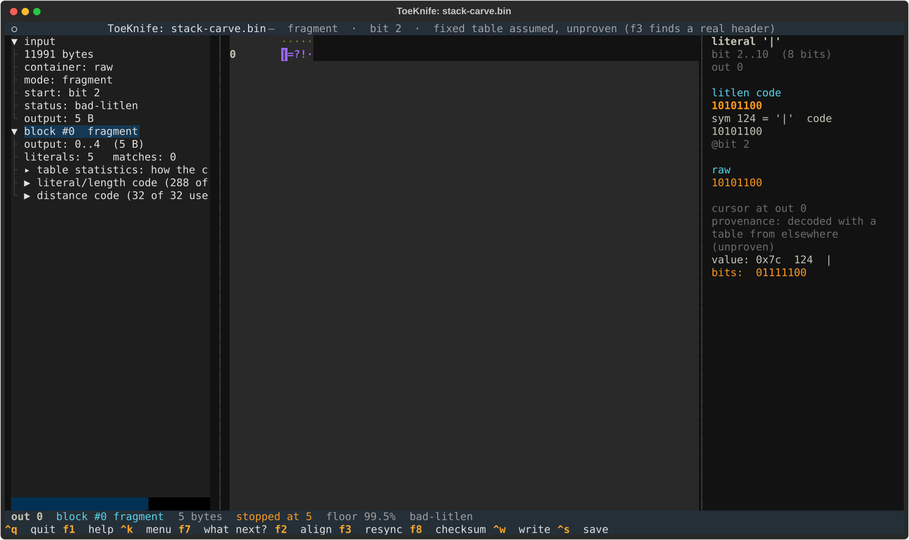
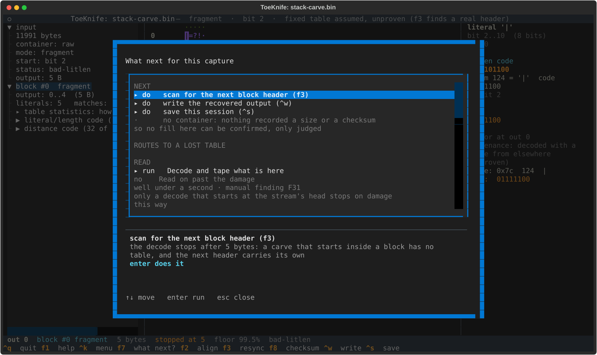
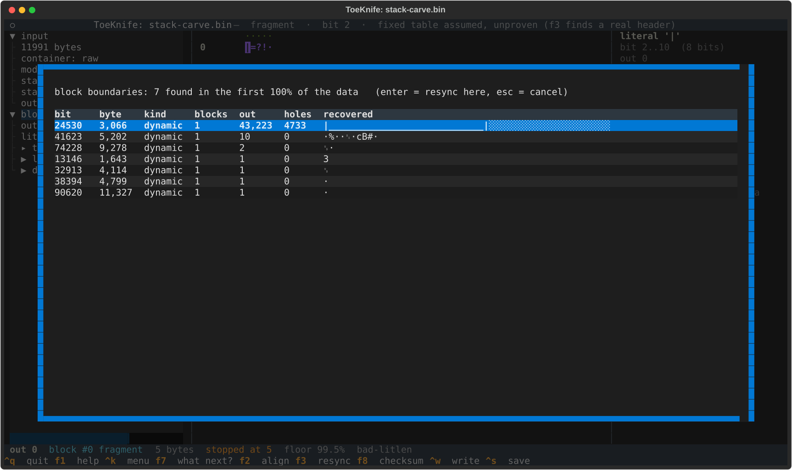
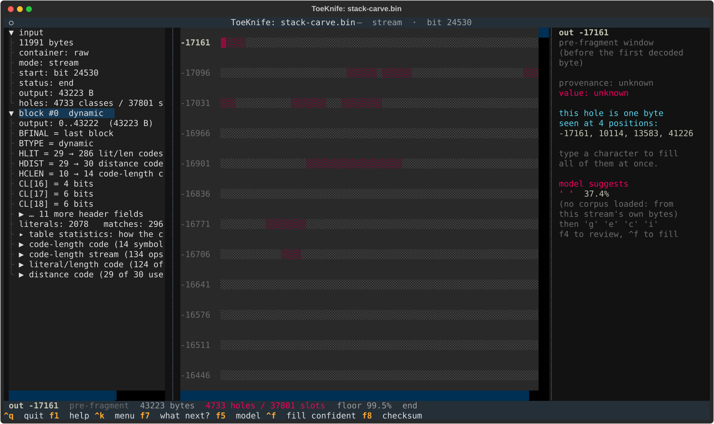
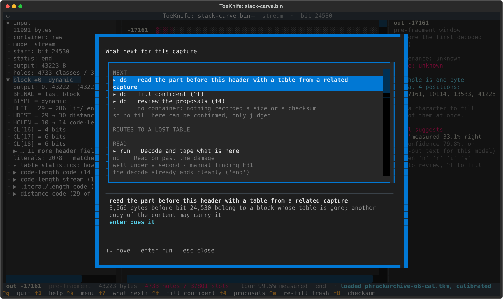
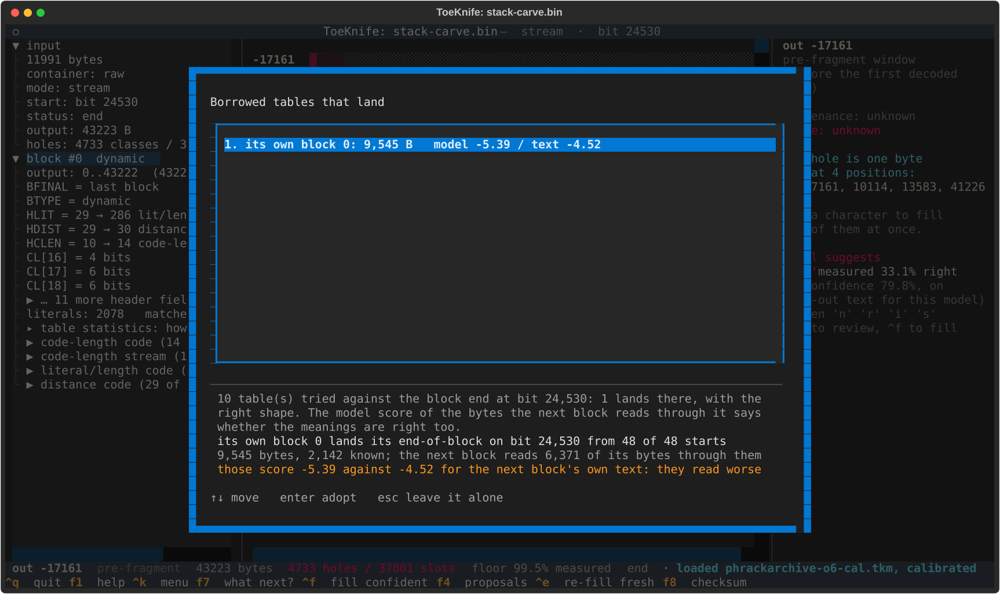
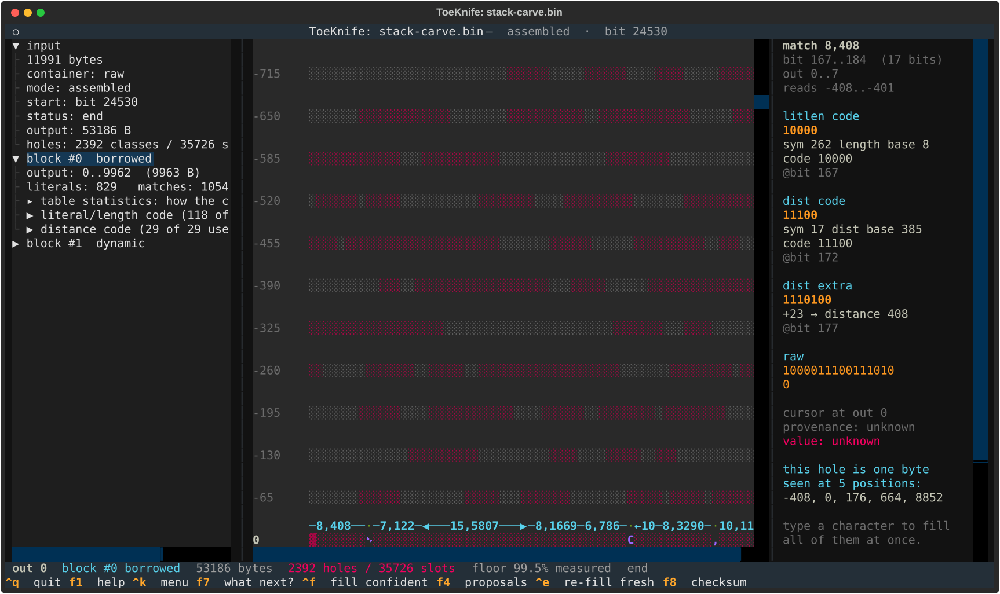
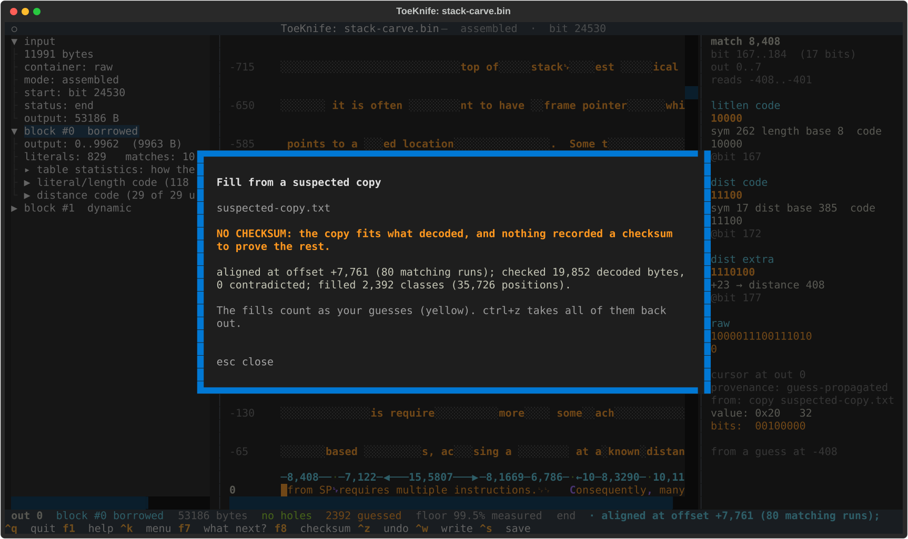

# E. Lost table

We have a carve that starts in the middle of a dynamic block. The block's
Huffman table was in the bytes that are gone, so every bit of the block that
survived is unreadable. The next block brings its own table, and ToeKnife
finds it and reads everything from there. For the part before it, another copy
of the content may hold the same table, and ToeKnife checks each table that
copy has against the block's end.

The specimen is `stack-carve.bin`: the Phrack article from
[Workflow A](a-carved-fragment.md) compressed with GNU gzip, which puts it in
two dynamic blocks, the second starting at output 17,724. The carve is the
compressed data with its first 3,000 bytes cut off: block 0's table and a
quarter of its body are gone.

## Make a specimen

```
python3 docs/manual/specimens.py p49-14.txt
```

That writes `stack-carve.bin`, plus two related captures: `mirror.txt.gz`, the
same article gzip'd again as a mirror would serve it, and
`edited-copy.txt.gz`, the copy from [B](b-lost-packet.md) with `One` changed
to `Two`. From a real file: `gzip -6 -n article.txt`, then
`tail -c +3011 article.txt.gz > carve.bin` skips the 10-byte gzip header and
3,000 bytes after it.

## 1. Open it

```
toeknife stack-carve.bin
```



`mode: fragment`, `status: bad-litlen`, `output: 5 B`. With no table to go on,
ToeKnife tries the fixed one, which is what [A](a-carved-fragment.md) needed.
Here it reads 5 bytes and hits a code the fixed table doesn't have. Those 5
bytes, `|=?!`, are blue: read with a table this stream didn't supply, and
wrong. The title bar says the same: `fixed table assumed, unproven (f3 finds
a real header)`. A fixed-table reading counts as read only once it runs
cleanly for 4,096 bytes, which a stream with its own tables never does.

`f7`:



The first row is `scan for the next block header (f3)`.

## 2. Find the next header

`f3`:



ToeKnife tries every bit for something that parses as a block header and
decodes from each one. Seven parse. Six of them are garbage that builds a
table and dies within 10 bytes. The one at bit 24,530 (byte 3,066) decodes
43,223 bytes to the final end-of-block. `enter`:



`mode: stream`, `start: bit 24530`, `output: 43223 B`, and `holes: 4733
classes / 37801 slots`. This is the article from output 17,724 on, and most
of it copies from block 0: those copies reach behind the start of what
decoded, into the red window above output 0, and only 10,155 of the 43,223
bytes are known. The cursor opens on the first hole, at -17,161.

## 3. Borrow the table

Block 0's last 3,066 bytes of compressed data are still in the file, before
bit 24,530. They need block 0's table. `f7` now has a row for that:



`enter`, then give it a related capture. The odds depend on how close the
content is, so try the closest first. With `edited-copy.txt.gz`:



ToeKnife takes every dynamic table in the related file, its own blocks first,
then zlib's tables for its content at levels 1 to 9, and decodes the bytes
before bit 24,530 with each one from 48 starting bits. A right table puts its
end-of-block exactly on bit 24,530. Here 10 tables were tried and 1 lands:
the edited copy's own block 0, from all 48 starts.

Landing proves the table's shape. The meanings can still be off. The edit
moved where gzip split the copy into blocks, from output 17,724 to 17,670,
and the original's one `^` in block 0 sits in the 54 bytes between. So the
copy's table differs from the original's in two symbols, `@` and `^`. The two parse the
same bits and decode them differently. The next block tells them apart. Its
holes copy from block 0, so once the two are joined those copies read
through the borrowed bytes, and wrong bytes there read as garbage. With a
model loaded (`f5`), ToeKnife scores them: `-5.39` for this table, against
`-4.52` for the next block's own text. They read worse. `esc` leaves it.

With `mirror.txt.gz`:


The same table position lands from all 48 starts, and the seam scores
`-3.85` against `-4.52`: it reads like the text. `enter` adopts it:



`block #0 borrowed`, output 0 to 9,962, then `block #1 dynamic`. `output:
53186 B`, and `holes: 2392 classes / 35726 slots`, from 4,733. The borrowed
bytes are blue and say `decoded with a table from elsewhere (unproven)`.
Checked against the article, none of the 53,186 is wrong; ToeKnife can't
know that, and doesn't claim it.

An unrelated article tried the same way, Phrack issue 49 file 13, offers 11
tables and none lands. A related capture that is plain text, such as
`edited-copy.txt` itself, offers zlib's tables only, and zlib never splits
this article where GNU gzip does: none lands either.

## 4. Check it

A carve records no size and no checksum. A copy of the content still tests
every byte that decoded. `^k`, `suspected`, `suspected-copy.txt`:



`NO CHECKSUM`. The copy lines up at offset +7,761, which says the carve's
first byte was output 7,761 of the article. It agrees with all 19,852 decoded
bytes it covers, the borrowed ones included, and fills the 2,392 open
classes. With no checksum to settle it, the borrowed bytes stay blue.

## 5. From the command line

```
toeknife stack-carve.bin --scan                       # the boundaries
toeknife stack-carve.bin --resync --export rest.txt   # from the next header
toeknife stack-carve.bin --resync --related mirror.txt.gz \
    --related-kind other --model ~/.toeknife/models/phrackarchive-o6-cal.tkm
```

`--related` reports what lands and how it scores:

```
10 table(s) tried against the block end at bit 24,530: 1 lands there, with the right shape. ...
  1. its own block 0: lands from 48 of 48 starts, 9,963 bytes, 7,494 read through by the next block, model -3.85 against -4.52
```

Adopting a table is done in the TUI.
