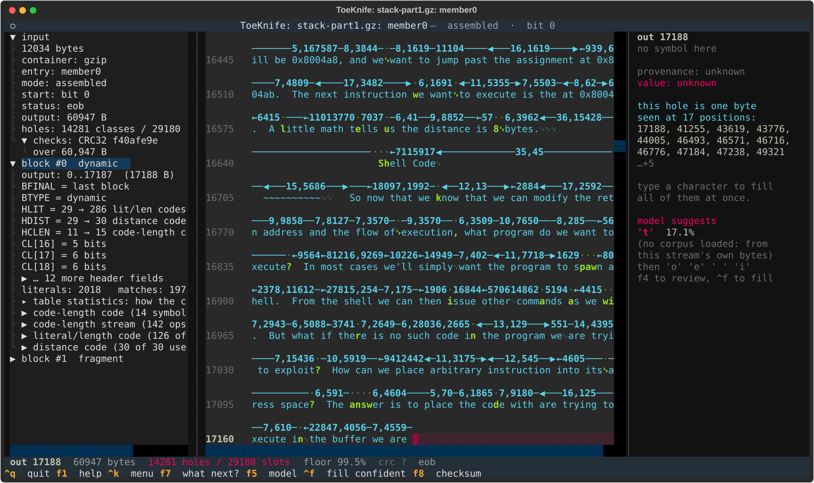
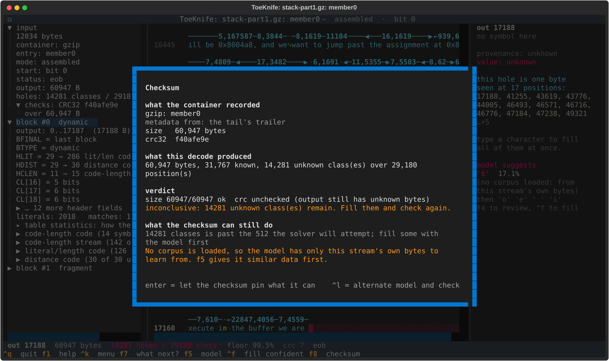
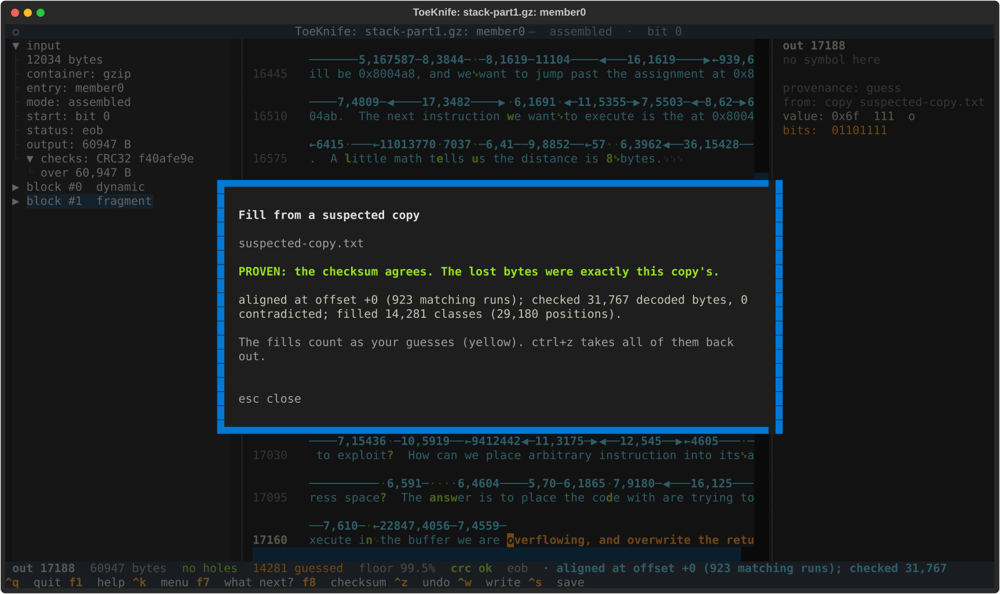

# F. Two fragments

We have two pieces of one gzip file, carved from a disk: the start, with the
gzip header, and a later piece running to the end of the file. The middle is
gone. ToeKnife reads both, finds where the second piece's bitstream starts,
and works out how many bytes the middle held. The gzip trailer at the end of
the second piece gives the size and CRC, so a copy of the content can prove
the whole file.

The specimens are `stack-part1.gz`, the first 6,000 bytes of the Phrack
article from [Workflow A](a-carved-fragment.md) gzip'd, and
`stack-part2.bin`, the same file from byte 9,000 to its end: 6,072 bytes,
the gzip trailer included. 3,000 compressed bytes are missing between them.

## Make a specimen

```
python3 docs/manual/specimens.py p49-14.txt
```

From a real file, `head -c 6000 article.txt.gz > part1.gz` and
`tail -c +9001 article.txt.gz > part2.bin` do the same.

## 1. The first piece alone

```
toeknife stack-part1.gz --verify
```

```
toeknife: member0: the last 8 bytes of the file give a length of 2,875,019,305, more than DEFLATE can produce from 5,982 bytes; the file is cut short, its trailer is gone, and nothing records the size or CRC
member0: nothing to check against
inconclusive: the decode stops at 17,188 bytes (truncated), and nothing recorded a size or checksum to check it against.
```

A gzip file ends with its CRC32 and length, so a gzip that can't be walked
to its end has those read from its last 8 bytes. On a cut-short file those
bytes are the middle of the stream. Here they say 2,875,019,305 bytes from
5,982 bytes of compressed data, and DEFLATE produces at most 1,032 bytes per
byte, so ToeKnife drops them. The real trailer is at the end of the second
piece.

## 2. Both pieces

```
toeknife stack-part1.gz --gap stack-part2.bin
```

```
gap: the tail ends on a final block with 8 bytes after it, a gzip trailer: CRC32 f40afe9e, 60,947 bytes
gap: the 48 ways of reading the first bits after the loss agree from bit 162; what they disagree on before it is counted as missing
gap: output gap of 14,281 bytes, from the recorded decompressed size
```

The second piece starts at a byte, and the bitstream at some bit within the
next 48. ToeKnife reads it from each of those 48 bits with the first piece's
table: the readings disagree for a few symbols and then land on the same
boundaries. It starts at the first one they all agree on, bit 162. The
second piece decodes to the stream's final end-of-block with 8 bytes after
it, which is the trailer: 60,947 bytes, CRC32 `f40afe9e`. The two pieces
produce 46,666 bytes between them, so the middle held 14,281.



The tape opens at the gap: output 17,188, the first unknown byte. The left
pane has `block #0 dynamic`, the first piece, and `block #1 fragment`, the
second. `holes: 14281 classes / 29180 slots`: the 14,281 missing bytes, and
the 14,899 places in the second piece that copy from them. `f8`:



`metadata from: the tail's trailer`, `size 60947/60947 ok`, and the CRC
waits for the 14,281 unknown bytes.

## 3. Prove it

`^k`, `suspected`, `suspected-copy.txt`:



The copy agrees with all 31,767 decoded bytes, fills the 14,281 classes, and
the CRC32 over the result is `f40afe9e`. `PROVEN`: the middle of the file
was exactly the copy's bytes.

Without a copy, a model can fill some of the gap (`^f`,
[Workflow B](b-lost-packet.md) shows how far that gets on this article).

## 4. When the second piece has no trailer

A piece that ends before the end of the file carries no trailer, and the
gap has to be searched for. ToeKnife tries every gap size up to `--gap-max`
(8,192 by default) and scores each one by how the second piece's copies
across the gap read: with the wrong size they copy the wrong bytes and read
as noise. A model makes the score much sharper; load one with `--model`.

Every gap size is scored with the model, split across the machine's
cores: 27 s for the default range here, on 8 cores, model load included,
and 88 s on one (`--gap-workers 1`). With `stack-part2.bin`'s trailer cut
off, the default range does not reach the true gap of 14,281:

```
gap: gap of 248 bytes, the best of 8,193 tried (5274 bytes read across it); a search result, which nothing here proves
gap: it scores -2.64, against a median of -2.92 over 200 gaps sampled; that barely stands out, so the gap may be past the 8,192 searched (--gap-max)
```

The best scores -2.64 against a median of -2.92: barely above a typical
wrong gap, and ToeKnife says so. With `--gap-max 20000` (35 s):

```
gap: gap of 14,281 bytes, the best of 20,001 tried (1613 bytes read across it); a search result, which nothing here proves
gap: it scores -1.69, against a median of -2.90 over 200 gaps sampled
```

That is the true gap, 1.21 above the median.

A searched gap is a candidate. Every copy in the second piece that reaches
back across it reads bytes the search chose, so those bytes are blue,
`copied across a searched gap (unproven)`, along with anything copied from
them. The second piece's own literals and its copies within itself stay
facts: they are right wherever the gap turns out to be.

## 5. Options

- `--gap-size N` uses a gap you already know.
- `--total-size N` gives the whole stream's decompressed size, which makes
  the gap arithmetic when no trailer survives.
- `--gap-workers N` sets how many processes score gaps: one per physical
  core unless you say. Each adds 0.22 GB to the model's memory, measured
  with 8.
- `--gap-max N` widens the search. The window is 32 KB, so past about
  24,000 bytes the second piece copies little from the first and the score
  has nothing to read.
