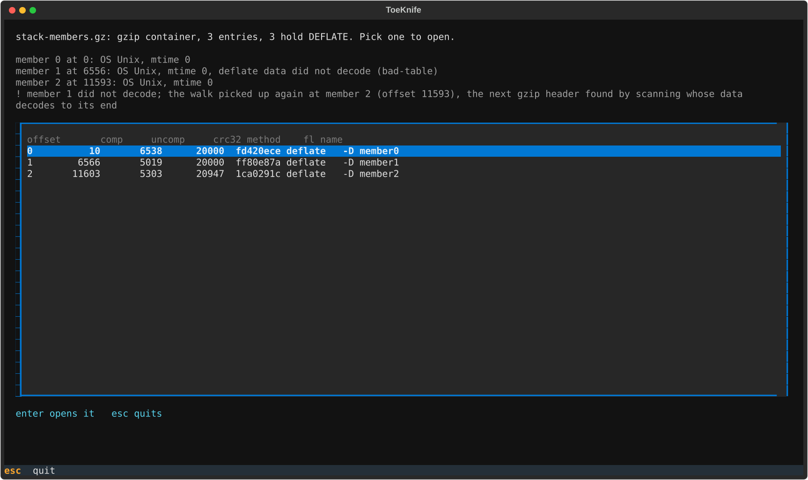
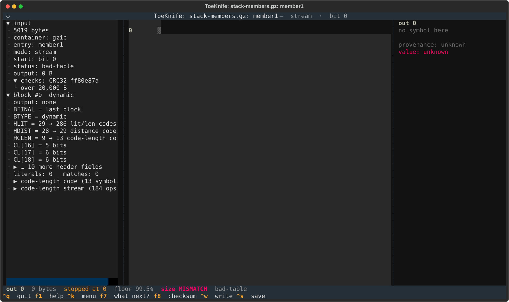
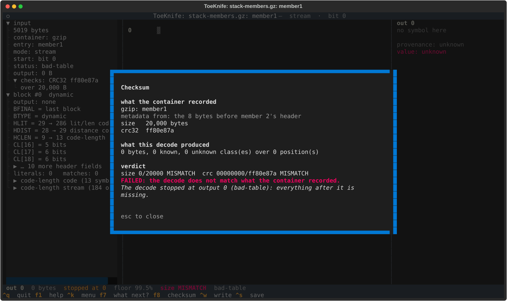
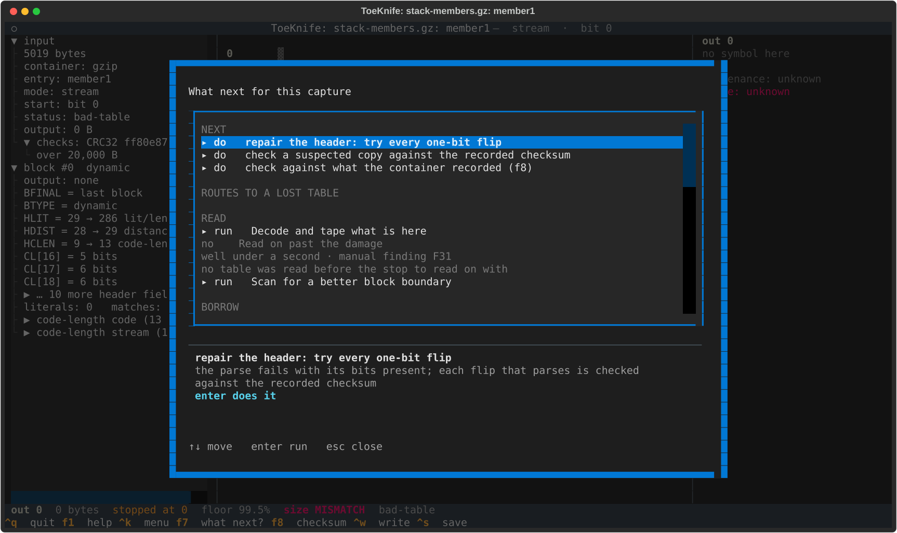
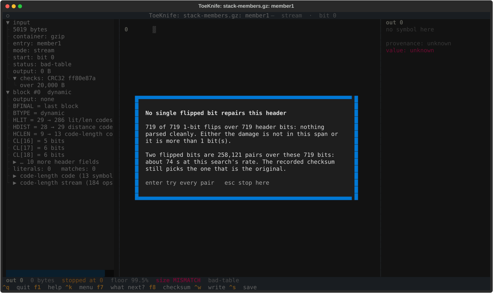
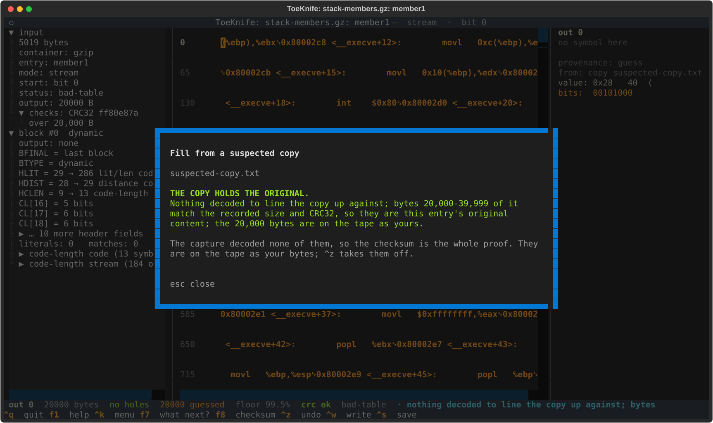
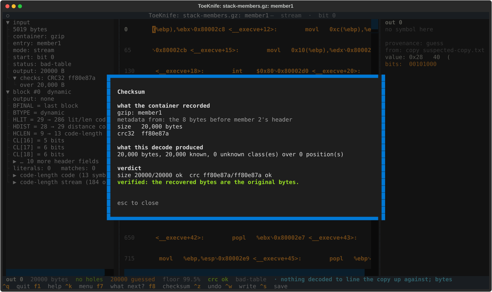
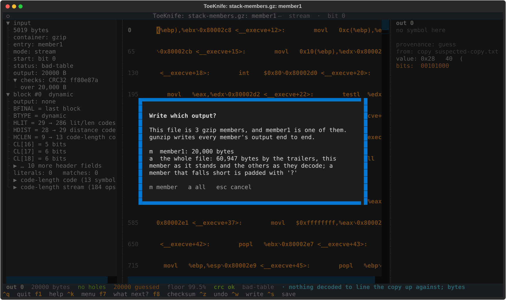

# G. Bad gzip member

A gzip file can hold several members end to end: `cat a.gz b.gz > c.gz` is
a valid gzip, and gunzip writes all three outputs back to back. Log
rotation, `pigz` and bgzip make files like this. Each member has its own
trailer, so each one can be proven on its own, and a damaged member costs
you that member only.

gzip records no compressed length. The only way to find where a member ends
is to decode it to its end-of-stream. When one member won't decode, ToeKnife
scans past it for the next gzip header whose data does decode, picks up the
walk there, and reads the damaged member's trailer from the 8 bytes in
front of that header.

The specimen is `stack-members.gz`: the Phrack article from
[Workflow A](a-carved-fragment.md) in three members (output bytes 0-19,999,
20,000-39,999 and 40,000-60,946), 16,914 bytes in all. Member 1 has 60
bytes of its DEFLATE data inverted from byte 40. Its Huffman table ends at
bit 589, so that takes the back half of the table and the first 26 bytes of
the body. The member is one block; with its table gone, none of it decodes.

## Make a specimen

```
python3 docs/manual/specimens.py p49-14.txt
```

From a real file, gzip three pieces separately and `cat` them, then damage
the middle one with a hex editor.

## 1. The listing

```
toeknife stack-members.gz
```

```
stack-members.gz: gzip container, 3 entries
  member 0 at 0: OS Unix, mtime 0
  member 1 at 6556: OS Unix, mtime 0, deflate data did not decode (bad-table)
  member 2 at 11593: OS Unix, mtime 0
  ! member 1 did not decode; the walk picked up again at member 2 (offset 11593), the next gzip header found by scanning whose data decodes to its end

  #      offset       comp     uncomp     crc32 method    fl name
  0          10       6538      20000  fd420ece deflate   -D member0
  1        6566       5019      20000  ff80e87a deflate   -D member1
       ! deflate data did not decode (bad-table)
       ! CRC32 and length read from the 8 bytes before member 2's header, where its trailer sits if nothing lies between the two members
  2       11603       5303      20947  1ca0291c deflate   -D member2
       ! found by scanning past member 1; decodes to its end
```

Member 0 walks normally. Member 1 stops on `bad-table`, so nothing says
where it ends. The bytes `1f 8b 08` at offset 11,593 parse as a gzip header,
and the data behind it decodes to an end-of-stream with a trailer after it:
that is member 2. Member 1 therefore runs from 6,566 to 11,584, and the 8
bytes at 11,585 are its trailer: 20,000 bytes, CRC32 `ff80e87a`.

The magic bytes `1f 8b` turn up in compressed data once in 65,536
positions, so a header counts as the next member only when the data behind
it decodes to an end.

Run it in a terminal and the same table is a picker:



## 2. The good members

```
toeknife stack-members.gz --entry all --verify
```

```
member0: output 0-19,999, 20,000 of 20,000 known, checksum ok
member1: output 20,000-39,999, 0 of 20,000 known, checksum incomplete
member2: output 40,000-60,946, 20,947 of 20,947 known, checksum ok
all: 60,947 bytes, 40,947 known; 2 of 3 members match their trailers
```

`--entry all` opens every member and puts them end to end, as gunzip
would. Members 0 and 2 match their trailers byte for byte. Member 1
contributes its 20,000 recorded bytes as unknowns, so member 2 still starts
at output 40,000.

## 3. The bad member

`enter` on `member1` in the picker, or `--entry 1`:



`output: 0 B`, `status: bad-table`. The left pane shows the header as far
as it parsed: 286 literal/length codes, 29 distance codes, and a code-length
stream that broke. `f8`:



`metadata from: the 8 bytes before member 2's header`. The size and CRC are
there to prove a repair; the decode has produced nothing to prove. `f7`:



The one-bit header repair from [Workflow D](d-bit-rot.md) comes first,
because a single flipped bit is the most common way a table breaks and the
search takes a fraction of a second. `enter`:



All 719 one-bit flips over the header fail to parse, and since the member
records a CRC, ToeKnife offers the next size up: every pair of bits,
258,121 of them. `enter` runs it; here it takes 41 s and no pair parses
either, since 60 inverted bytes are 480 wrong bits. The table can't be
read back, and every symbol in the body is read through it, so the
bytes of this member have to come from somewhere else.

## 4. Prove it with a copy

The second row on `f7` is `check a suspected copy against the recorded
checksum`. Give it `suspected-copy.txt`, the whole article:



With nothing decoded, there is nothing to line the copy up against. The
recorded size and CRC are enough: ToeKnife slides a 20,000-byte window
along the copy until its CRC32 equals `ff80e87a`, and finds it at bytes
20,000-39,999. That takes 0.14 s on the 60,947-byte copy. The window's bytes
go on the tape as yours (yellow), and `^z` takes them off. `f8`:



A copy edited anywhere in those 20,000 bytes has no window that matches,
and ToeKnife says so.

## 5. Write the whole file

`^w` on a member of a multi-member gzip asks which output you want:



`m` writes member 1's 20,000 bytes. `a` writes the whole file: this member
as it stands on the tape, the others as they decode. From the command line
the same thing is

```
toeknife stack-members.gz --entry all --fill-from suspected-copy.txt --export stack.txt --verify
```

```
copy: member1: nothing decoded to line the copy up against; bytes 20,000-39,999 of it match the recorded size and CRC32, so they are this entry's original content; the 20,000 bytes are on the tape as yours
member0: output 0-19,999, 20,000 of 20,000 known, checksum ok
member1: output 20,000-39,999, 20,000 of 20,000 known, checksum ok
member2: output 40,000-60,946, 20,947 of 20,947 known, checksum ok
all: 60,947 bytes, 60,947 known; 3 of 3 members match their trailers
```

`--fill-from` is tried on each member that doesn't already match its
trailer. `stack.txt` is the article, all 60,947 bytes.

Without a copy, `--export` still writes the file with member 1 as 20,000
`?` bytes (`--fill` picks another byte), and everything around it in place.

## 6. When it goes differently

- **Damage in the body, table intact.** The member decodes up to the damage
  and stops. [Workflow C](c-damaged-zip.md), section 4, reads on past it;
  the trailer found here is what a copy is checked against.
- **The last member is damaged.** Nothing follows it, so its trailer is
  the last 8 bytes of the file, and ToeKnife reads it from there.
- **Two damaged members in a row.** The walk picks up again at the first
  member after them that decodes. Every gzip header between is a damaged
  member, ending where the next header starts, and each gets the trailer in
  front of that header. Work on each with `--entry`.
