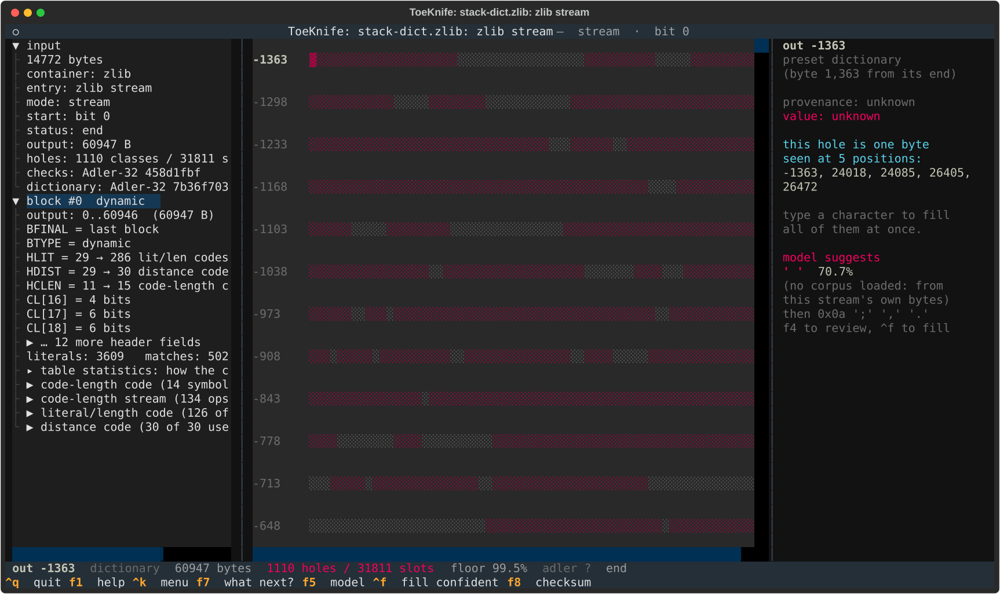
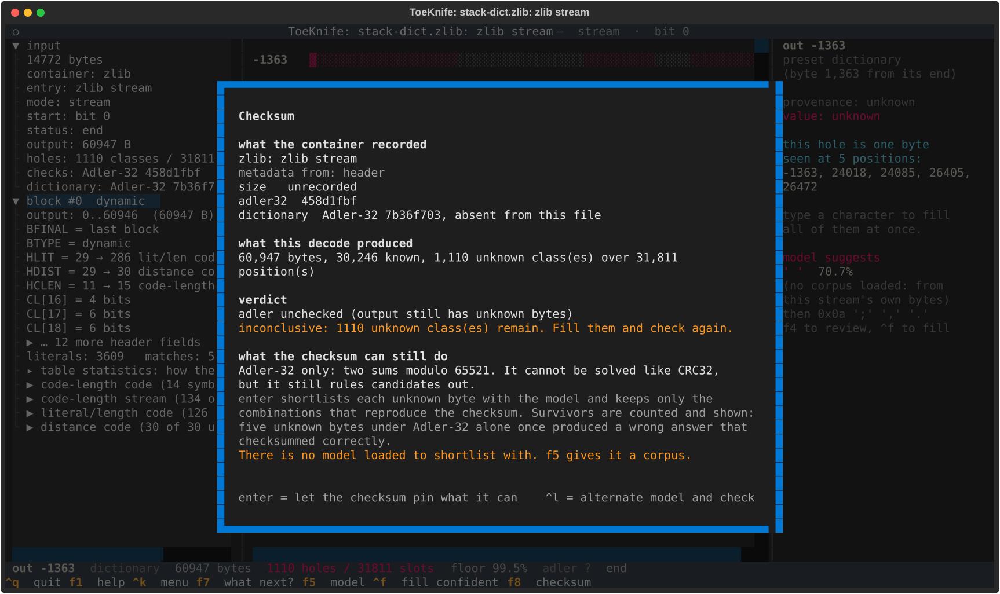
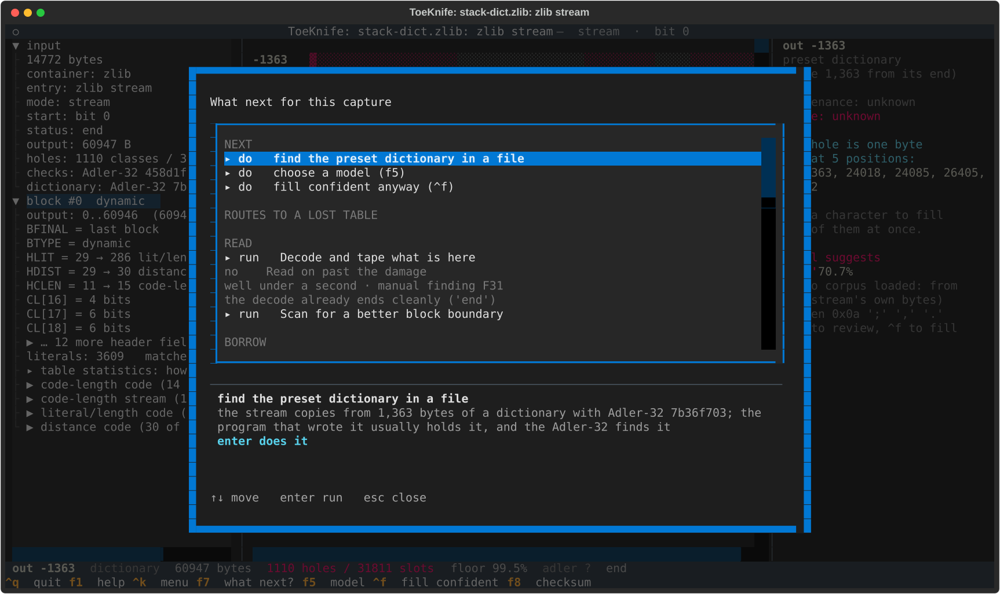
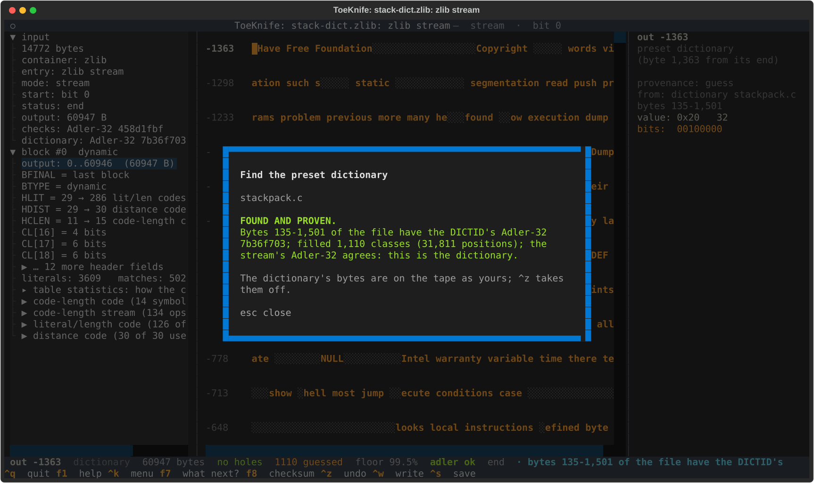
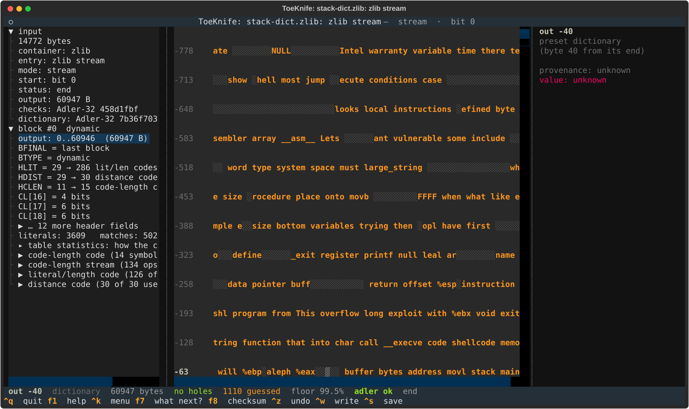
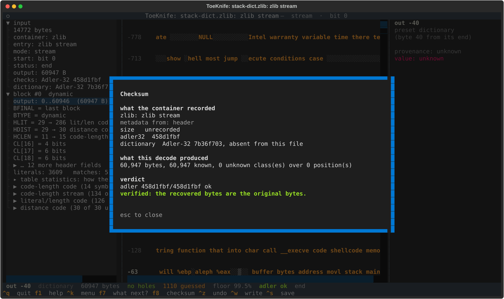
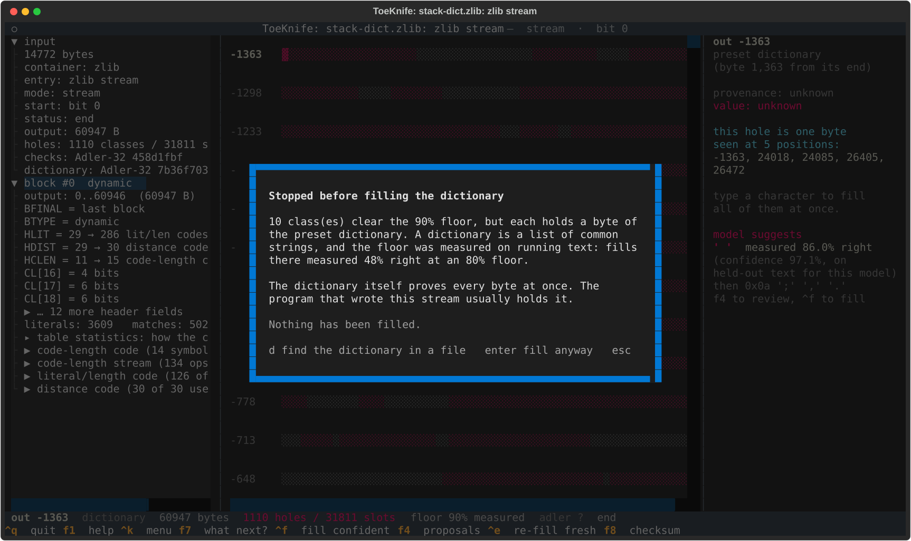

# H. Missing dictionary

zlib can compress against a preset dictionary: a block of bytes both sides
agree on beforehand, which the stream copies from as if it were output that
came before the first byte. The dictionary is not in the stream. The header
carries only its Adler-32, the DICTID, and zlib without the dictionary stops
at the first byte with `Error 2`, Z_NEED_DICT.

ToeKnife decodes it anyway. Copies that reach into the dictionary become
holes in front of output 0, and the DICTID finds the dictionary in any file
that holds it: the program that wrote the stream, usually. The stream's own
Adler-32 then proves the result.

The specimen is `stack-dict.zlib`: the Phrack article from
[Workflow A](a-carved-fragment.md), zlib level 6, against a 1,367-byte
dictionary of its 200 commonest words. That is how zlib's documentation says
to build one: strings common in the data, the commonest last, where copies
from them are shortest. It saves 278 bytes (15,060 compressed without it,
14,782 with). `stackpack.c` is the program that wrote it, with the
dictionary as a string constant.

## Make a specimen

```
python3 docs/manual/specimens.py p49-14.txt
```

From your own data, Python makes one:

```
python3 -c 'import zlib,sys; d=open(sys.argv[1],"rb").read(); c=zlib.compressobj(zdict=d); sys.stdout.buffer.write(c.compress(open(sys.argv[2],"rb").read())+c.flush())' dict.txt data.txt > out.zlib
```

## 1. Open it

```
toeknife stack-dict.zlib --verify
```

```
toeknife: zlib stream: compressed against preset dictionary 7b36f703, which is not in this file: references reaching into it become holes
zlib stream: adler unchecked (output still has unknown bytes)
inconclusive: 1110 unknown byte classes remain (31811 positions). Fill them and check again.
```



The tape starts at -1,363: the stream copies from as far back as 1,363
bytes before its first byte, so the dictionary is at least that long. Each
red cell there is one dictionary byte the stream copies, and its class
holds every output position copied from it. The one under the cursor,
dictionary byte 1,363 from the end, turns up at outputs 24,018, 24,085,
26,405 and 26,472. 1,110 dictionary bytes are copied, into 31,811 output
positions: more than half the article. The grey cells between are
dictionary bytes nothing copies.

The left pane has `dictionary: Adler-32 7b36f703`, and `f8` lists it with
what the container recorded:



## 2. Find the dictionary

`f7`:



`enter`, and give it `stackpack.c`:



A dictionary's Adler-32 is two sums over its bytes, so any run of a file
can be checked against the DICTID in constant time from two prefix sums.
ToeKnife tries the whole file first, then every run at least 1,363 bytes
long: bytes 135-1,501 of `stackpack.c` match `7b36f703`. Adler-32 is 32
bits, and a large file holds chance matches: with the dictionary planted in
the middle of 300 KB of a binary there were 13 in 1.5 s, and in 3 MB, 1,072
in 65 s. Each match is inflated against the stream, and only the true
dictionary reproduces the stream's Adler-32, `458d1fbf`.

The 1,110 dictionary bytes go on the tape as yours (yellow). `^z` takes
them off.



The tape before output 0 now reads as the word list, with gaps where the
stream never copies. `f8`:



`^w` writes the 60,947 bytes of output. The dictionary is not part of it.

From the command line:

```
toeknife stack-dict.zlib --dict stackpack.c --export stack.txt --verify
```

```
dict: bytes 135-1,501 of the file have the DICTID's Adler-32 7b36f703; filled 1,110 classes (31,811 positions); the stream's Adler-32 agrees: this is the dictionary
zlib stream: adler 458d1fbf/458d1fbf ok
verified: the recovered bytes are the original bytes.
```

## 3. Where to look

The dictionary has to be byte-exact, so it is wherever the writer kept it:

- the program's source, as a string constant, or its binary, where the
  same constant sits in the read-only data;
- a file the program ships or loads (`*.dict`, a resource);
- for a protocol, the specification: SPDY's header dictionary is printed
  in its RFC draft.

Give `--dict` the whole file. The search grows with the square of its size:
3 MB takes about a minute, and the TUI shows its progress and stops on
`esc`.

## 4. Without the dictionary

A model can fill dictionary bytes like any others, and it does it badly.
Load the calibrated Phrack model (`f5`), set the floor to 0.9, and `^f`:



10 classes clear the floor on the first round, and `^f` stops before filling
any of them. The floor was calibrated on bytes in running text, and a dictionary
is a word list in frequency order. Filled anyway (`enter`, or
`--fill-dictionary` on the command line), the run fills 38 of the 1,110
classes and 10 are right. At an 80% floor it takes 44 seconds and fills 220;
106 of them are right, 48%. By output position it does better, 5,914 of
7,598 right (77.8%), because the commonest words are copied most and are the
easiest to guess.

The Adler-32 can't pin bytes the way a CRC32 can, so it won't finish the
job; it only says whether a fill is right once no holes are left. `d` goes
back to looking for the dictionary.
