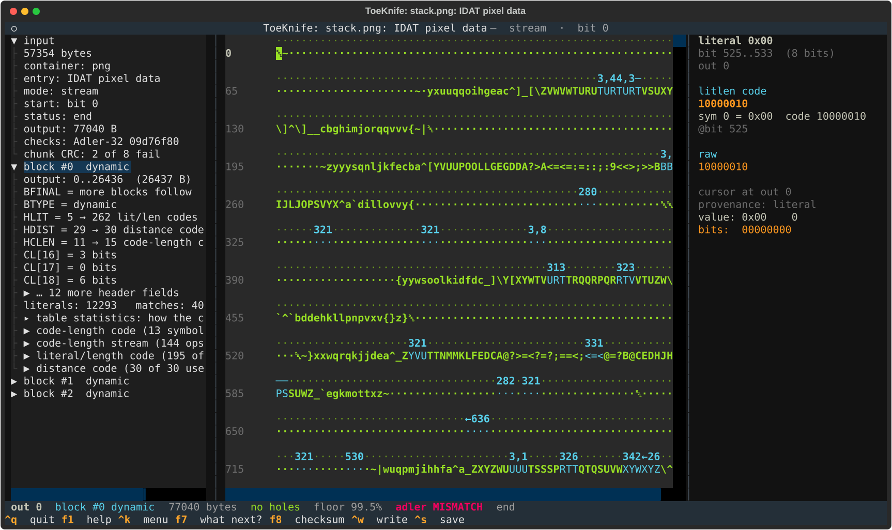
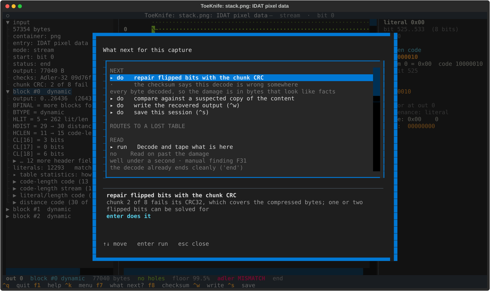
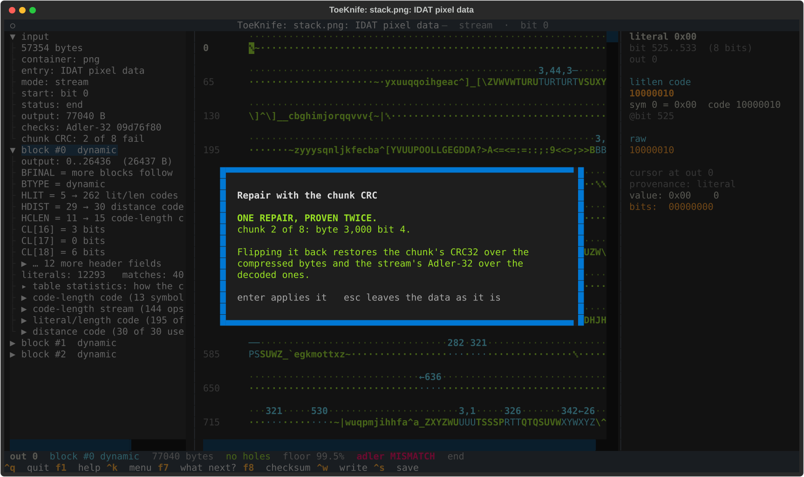
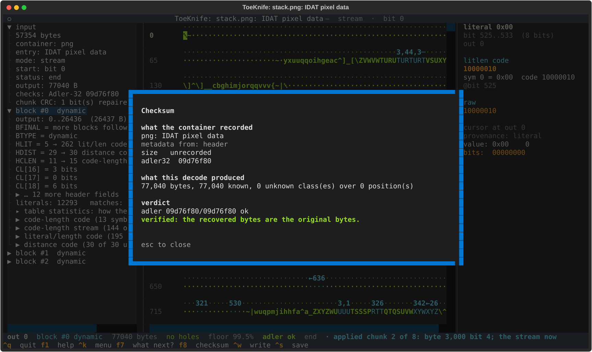
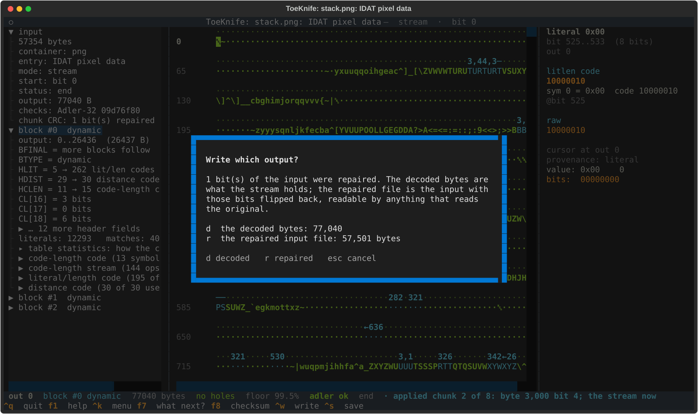
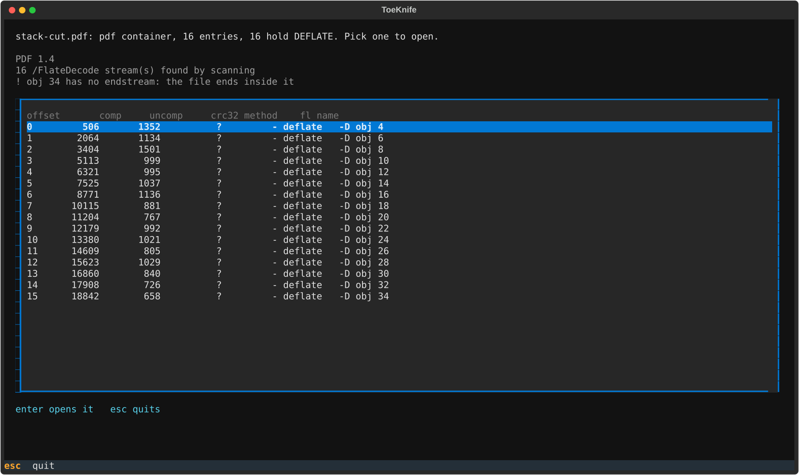
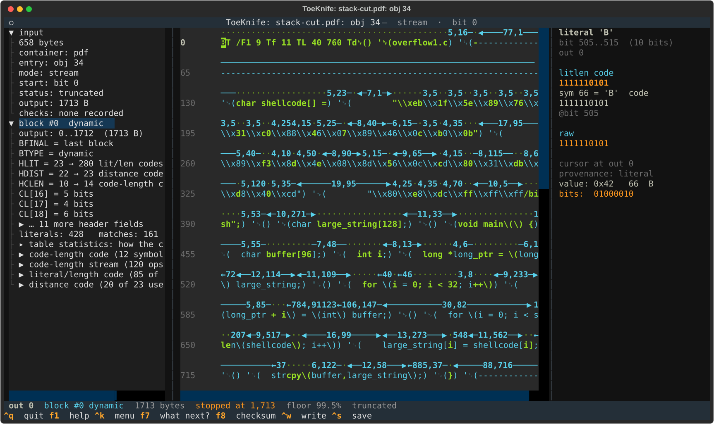

# I. Inside other formats

PNG, PDF, SWF, WOFF, TIFF and Minecraft region files all keep DEFLATE in a
zlib wrapper inside their own structure. ToeKnife finds the streams, joins
them where the format splits them, and checks each against its Adler-32. The
wrapper often holds more than that. A PNG keeps a CRC32 over every chunk of
compressed data, and that is enough to find and undo one or two flipped
bits without a model. A PDF can be read without its cross-reference table,
which is the part a carve loses first.

Three specimens, all built from the Phrack article of
[Workflow A](a-carved-fragment.md) or alongside it:

- `stack.png`: a 320x240 greyscale picture, 77,040 bytes of pixel data
  compressed into eight IDAT chunks of up to 8,192 bytes, 57,501 bytes in
  all. One bit is flipped: byte 3,000 of chunk 2, bit 4.
- `stack.pdf`: the article set in Courier on 30 pages, one compressed
  content stream per page, 32,895 bytes.
- `stack-cut.pdf`: its first 19,500 bytes, as a carve that ran into
  something else.

## Make a specimen

```
python3 docs/manual/specimens.py p49-14.txt
```

## 1. A PNG with a flipped bit

```
toeknife stack.png --verify
```

```
opening the only DEFLATE entry: IDAT pixel data
toeknife: IDAT pixel data: gathered from 8 IDAT chunk(s)
toeknife: IDAT pixel data: IDAT chunk 2 of 8 (file offset 8,237) fails its CRC: the damage is in its 8,192 bytes, stream bytes 8,192-16,383
IDAT pixel data: adler 44366e7d/09d76f80 MISMATCH
FAILED: the decode does not match what the container recorded.
```

The stream decodes to the end, all 77,040 bytes, and 10 of them are wrong:
the flipped bit changed one symbol, and back-references copied the damage
down the image from row 44 to row 230. Nothing in the decode looks broken.
The Adler-32 over the pixels says something is wrong, and the chunk CRC
says where.



`chunk CRC: 2 of 8 fail` in the left pane. `f7`:



`enter`:



CRC32 is linear. Flipping bit *i* of a chunk changes its CRC by an amount
that depends only on *i* and the chunk's length, so ToeKnife computes that
amount for all 65,536 bits of the chunk, and the bit whose amount equals the
change the damage made is the one that flipped. Two flipped bits are a pair
of amounts that combine to it, found in the same pass with a table. On this
chunk the search takes 0.14 s and finds one bit: byte 3,000, bit 4.
Flipping it back also makes the 77,040 decoded bytes match the Adler-32, a
second check, over different bytes. `enter` applies it, and `f8`:



`^w` now asks what to write:



`d` writes the 77,040 decoded bytes: filtered scanlines, a filter byte
then 320 pixels per row. `r` writes the PNG itself with the bit flipped
back, which any viewer opens. On the command line:

```
toeknife stack.png --chunk-repair --write-repaired fixed.png --verify
```

```
chunks: 1 repair(s) restore the chunk CRC and the stream's Adler-32: chunk 2 of 8: byte 3,000 bit 4
chunks: applied chunk 2 of 8: byte 3,000 bit 4
wrote 57,501 bytes to fixed.png: the input with 1 bit(s) flipped back
IDAT pixel data: adler 09d76f80/09d76f80 ok
verified: the recovered bytes are the original bytes.
```

`fixed.png` is byte for byte the PNG before the bit flipped.

When it goes differently:

- **The CRC itself took the hit.** One bit of the stored CRC wrong, the
  data intact: the repair says so and changes nothing.
- **Three or more bits.** No one- or two-bit change restores the CRC, and
  the repair says that. The chunk still says where the damage is, and the
  decode is the place to look: [Workflow C](c-damaged-zip.md), sections 3
  and 4.

## 2. A PDF with its end cut off

A PDF's cross-reference table, which says where every object starts, is at
the end of the file. ToeKnife reads the file from the front instead: it
looks for each `stream` keyword, reads the dictionary in front of it, and
keeps the ones with `/FlateDecode`.

```
toeknife stack-cut.pdf
```



16 of the 30 page streams survive. Each is named by the object it belongs
to: the page contents are objects 4, 6, 8 and on. `obj 34` has no
`endstream`, so the file ends inside it, and its Adler-32 went with the
rest. Pick it:



`status: truncated`, 1,713 bytes: the page's text operators up to where
the carve stops. The page held 2,531. Nothing records its size or checksum,
so there is nothing to check those 1,713 bytes against, and nothing to say
how much is missing.

The other 15 streams are whole and each one checks:

```
toeknife stack-cut.pdf --entry 0 --verify
```

```
obj 4: adler 2e7ec345/2e7ec345 ok
verified: the recovered bytes are the original bytes.
```

`--entry N --export FILE` writes one stream's decoded bytes. A page
content stream is PDF drawing operators: the text is in the parentheses,
one line per `'`.
