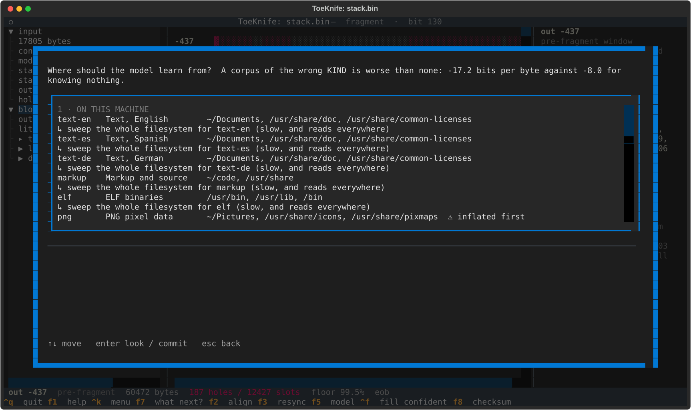
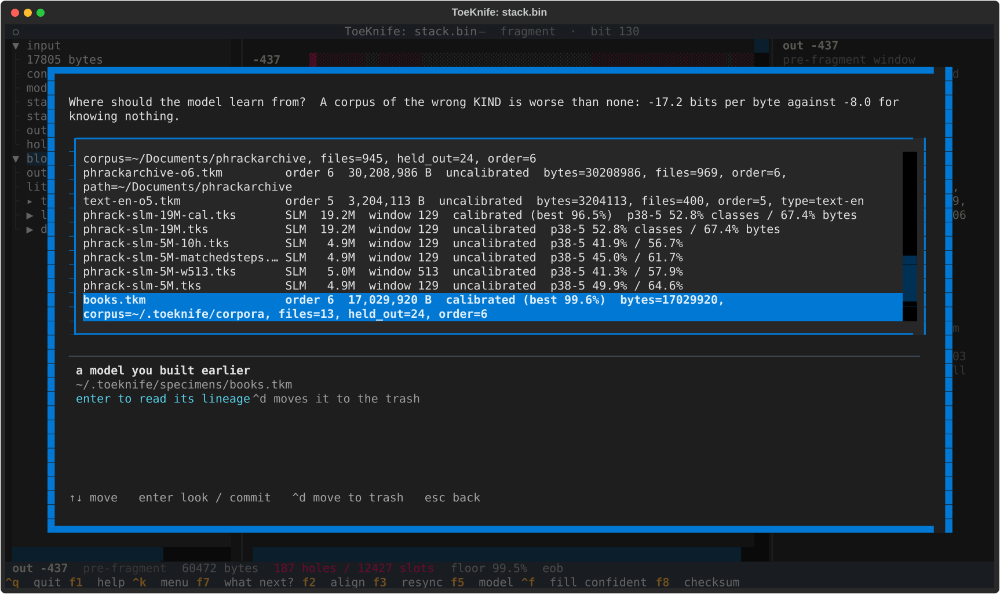
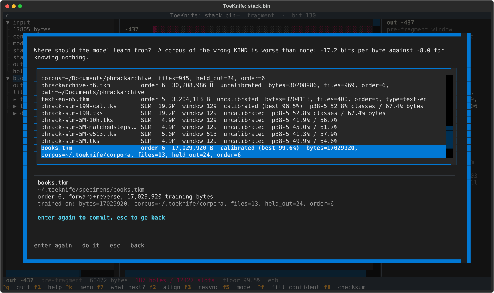
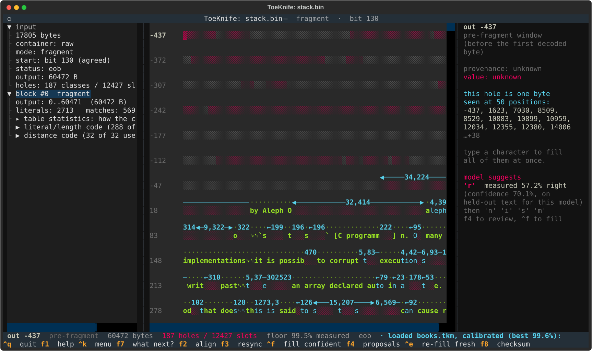
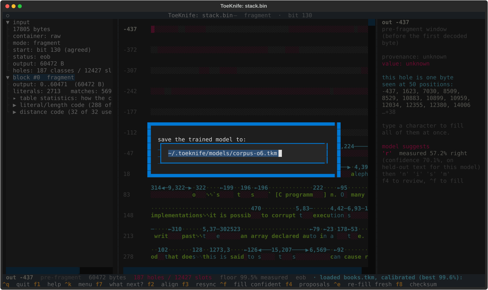
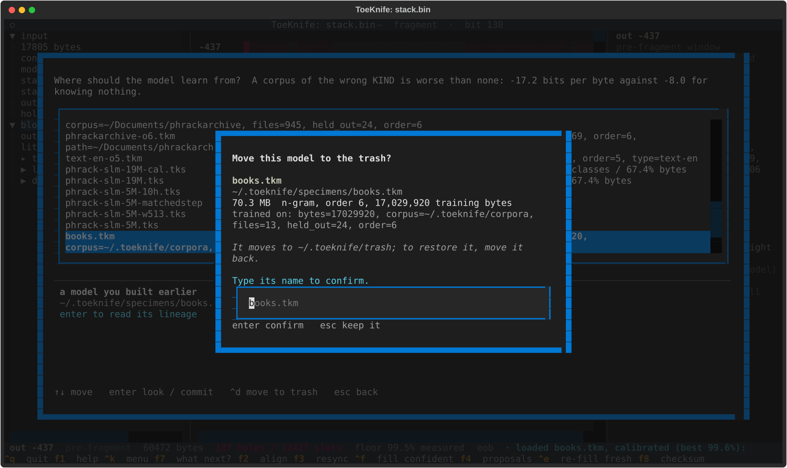
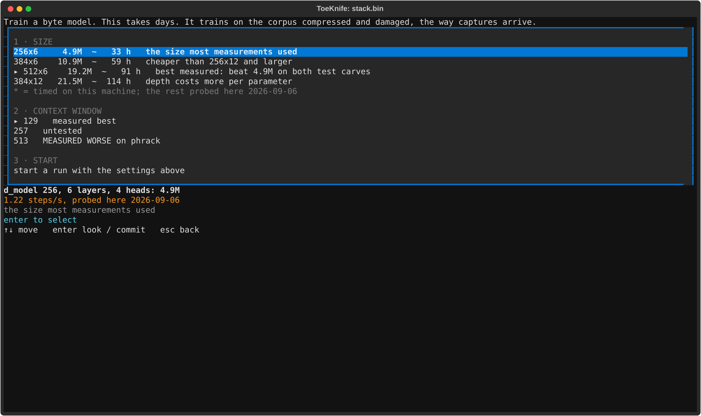
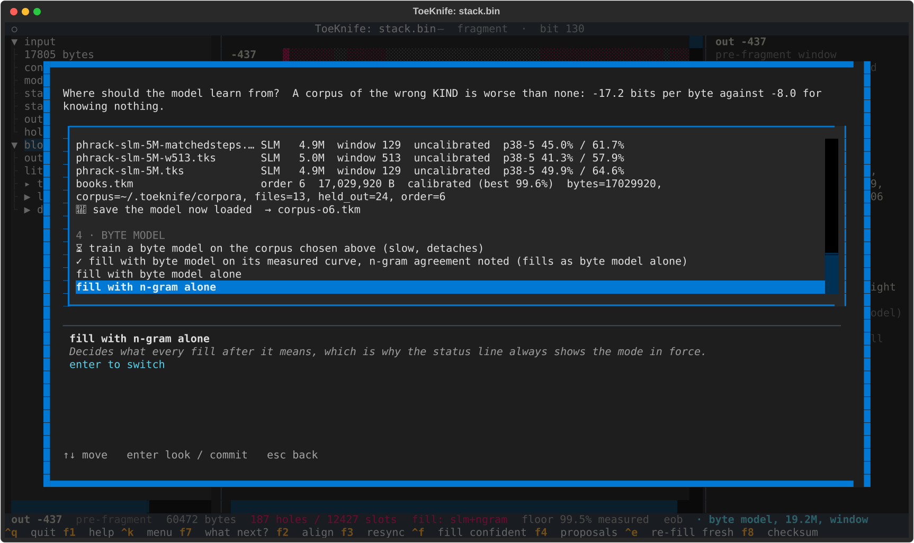

# Models

A model fills holes. ToeKnife has two kinds:

- **n-gram** (`.tkm`): counts of which byte follows which context of up to
  6 bytes, trained both ways so a hole can be judged from the bytes on
  either side. Minutes to train. Everything in the workflows uses one.
- **byte model** (`.tks`): a small neural network that reads the tape
  itself, unknown bytes included, and answers a whole class at once.
  Takes 1 to 5 days to train; about 40 times slower per hole than the n-gram
  when filling; needs `pip install 'toeknife[ml]'`.

The kind of data matters more than anything else about a model. Trained on
the wrong kind it scores -17.2 bits per byte, where knowing nothing at all
scores -8.0. A model of English text on an ELF binary is worse than no
model.

## Choosing a corpus

`f5`:



1. **On this machine.** Types of data and where this machine has some:
   `text-en` in `~/Documents` and `/usr/share/doc`, `elf` in `/usr/bin`.
   Directories next to the capture that are mostly text are listed first,
   as `here`. `png` is inflated before training, since training on
   compressed bytes teaches nothing.
2. **From outside.** Downloads, fetched only when you confirm.
3. **Models you built earlier.**
4. **Byte model.** Training one, and the fill mode.

Every row does nothing on the first `enter` except say what it would read:
which directories, how many files, how many bytes. The second `enter`
commits.

From the command line:

```
toeknife --corpus ~/.toeknife/corpora --save-model books.tkm
```

```
corpus: 13 file(s), 17,926,231 bytes; context order 6 (from its size); roughly 4.5 GB of memory, give or take a factor of two; about 13 min at this machine's measured 21.6 KB/s for order 6
toeknife: calibrating on held-out documents...
toeknife: calibrated on 202,319 held-out classes from 24 document(s); best measured precision 99.6%
toeknife: near a gap, held-out classes under each floor: 70% on 14,752, 80% on 166, 90% on 137
trained order-6 on 17029920 bytes from 13 file(s); wrote 70301333 bytes to books.tkm
```

Thirteen Project Gutenberg books: 15 minutes on this machine, and the
model is 70 MB. The `near a gap` line counts the held-out holes beside a
lost packet that each floor rests on. Before it starts, training says what
it expects to cost in memory and in time. The time comes from the last run
at the same order on this machine, kept in `~/.toeknife/rates.json`; until
there is one, from a reference rate of 32.2 KB/s measured on another
machine. The order comes from the corpus size unless `--order`
sets it: 3 under 32 KB, 4 under 128 KB, 5 under 8 MB, 6 above. Below a few
megabytes the kind of data matters far more than the order.
`--corpus-type text-en` trains on every file of that type in the places
this machine keeps it, and `--corpus-types` lists the types.

## Calibration

Training holds part of the corpus back: every 20th file, up to 24 spread
evenly across the corpus, the first 32 KB of each. With fewer than 4 files
to choose from it holds back the tail of the corpus in pieces instead,
which is what happened above.
The rest trains the model. The held-back text is then damaged the ways
captures arrive damaged:

- compressed, its first table destroyed, and read from the next block, as
  a carve is;
- compressed with the fixed table and its front cut off;
- with a 536-byte packet cut out, at five places in turn.

Every hole that leaves is filled once and checked against the real text.
What the model got right, at each confidence, is stored in the model file,
so the numbers travel with it to any machine.

## How accurate are the fills?

The floor on the status line is one of these measured precisions:
`floor 90% measured` fills only what this model got right at least 90% of
the time on text it never saw. The side pane quotes the same figure for
the hole under the cursor: `measured 57.2% right (confidence 70.1%, on
held-out text for this model)`.

Here is what `phrackarchive-o6-cal.tkm`, trained on 945 Phrack articles
with 24 held back, measured on 149,064 held-out holes:

| where the hole is | its confidence | right |
|---|---|---|
| short hole in decoded text | 0.9990 and up | 96.1% to 97.8% (252) |
| | 0.9952 to 0.9990 | 90.7% to 93.3% (360) |
| | 0.962 to 0.9952 | 86.1% to 87.9% (1,513) |
| | 0.895 to 0.962 | 79.5% to 83.0% (2,047) |
| | 0.814 to 0.895 | 39.6% to 67.2% (7,340) |
| | below 0.814 | 33.1% or less (10,463) |
| beside a lost packet | 0.9992 and up | 80.4% to 95.0% (75) |
| | 0.9926 to 0.9992 | 72.4% to 73.6% (436) |
| | 0.853 to 0.9926 | 65.3% to 69.8% (5,188) |
| | below 0.853 | 33.3% or less (45,945) |
| deep inside a long unread run | any | 18.0% (75,445) |

The figures in parentheses are how many holes each one rests on. Three
things to read off it:

- **Confidence is not precision.** Short holes between 0.814 and 0.895
  confidence were right 39.6% to 67.2% of the time, and beside a lost
  packet a hole at 0.99 confidence was right 69.8% of the time.
- **Beside a lost packet is harder** than a hole in decoded text at the
  same confidence: the context on one side is missing too. The model is
  rarely sure there, so the top steps rest on few holes: 75 at 80% and
  up, 18 at 95%. The floor picker shows the count beside each floor.
- **Inside a long run of unread output** (256 bytes or more), fills are
  wrong four times out of five whatever the confidence, because each fill
  becomes context for the next. `^f` stops before filling there and asks.
  It also stops before filling bytes of a missing preset dictionary, which
  measured 48% right at an 80% floor ([Workflow H](h-missing-dictionary.md)).

A model trained before calibration existed says `uncalibrated` in `f5`,
and its floor is raw confidence. Raw confidence overstates: the same 0.995
floor gave 99% precision on a carve of licence text, 65% on a carve of a
Phrack article, and 19% inside a lost packet's gap. Retrain it.

The checksum is the only thing that proves a fill. A calibrated floor
says how often the model is right; `f8` says whether it was right this
time.

## Loading

`f5`, section 3:



Each row has the order, the training bytes, the calibration and where it
was trained from. The section lists `~/.toeknife/models`, the working
directory, and any directory in `TOEKNIFE_MODELS` (colon-separated).
`enter` reads the lineage:



`enter` again loads it:



The footer says `floor 99.5% measured`, and the side pane gives each hole
the model's measured precision. From the command line, `--model FILE`.

## Saving

A model trained from `f5` lives in memory until it is saved. `^k` "save
the loaded model":



The suggested name comes from the corpus and the order; a name already
taken gets `-2`. The file goes to `~/.toeknife/models` unless you give
another path.

## Removing

Highlight a saved model in `f5` and `^d`:



Type its name to confirm. It moves to `~/.toeknife/trash`, metadata and
all; moving it back restores it.

## Byte models

`^k` "train a byte model", or section 4 of `f5`:



The hours are this machine's: rows marked `*` were timed on runs here, the
rest come from a short probe. The run trains on the corpus chosen in `f5`,
compressed and damaged the way captures arrive. It detaches: quit
ToeKnife and it keeps going, and the clock it shows stops while the
machine sleeps. The screen lists past runs at the top when there are
any. `enter` on a running one shows its log. On a finished one it asks
for a name, `phrackarchive-slm-19.2M.tks` by default, and copies the best
checkpoint into `~/.toeknife/models` with the run's corpus, size, steps and
val top-1 inside. `f5` lists it in section 3 from then on.

A loaded byte model adds the fill mode to section 4:



The mode decides which confidence the floor reads:

| mode | the floor reads |
|---|---|
| n-gram alone | the n-gram's confidence, on the n-gram's curve |
| byte model alone | the byte model's confidence, on the byte model's curve; raw confidence when it has none |
| byte model, where the n-gram agrees | with a calibrated byte model, the same as byte model alone; otherwise the n-gram's confidence, and only where the two name the same byte |

The status line shows the mode in force: `fill: slm+ngram`.

From the command line, `--byte-model FILE.tks`, and `--fill-mode` picks
`both` (the default with a byte model), `slm` or `ngram`. On Workflow A's
fragment at a 90% floor:

```
toeknife stack.bin --model ~/.toeknife/models/phrackarchive-o6-cal.tkm \
    --byte-model ~/.toeknife/models/phrack-slm-19M-cal.tks --fill-mode slm \
    --solve --solve-confidence 0.9 --export filled.bin
```

```
byte model, 19.2M, window 129, trained on phrackarchive: -4.5 bits/byte, 56% of known bytes right
confidence floor: measured precision, the byte model's curve (calibrated on 413,201 held-out classes from 217 document(s); best measured precision 96.5%)
solver: filled 89 of 187 classes (9815 output positions) in 4 rounds; stopped because nothing here measured 90% right for this model; the best open class measured 89.54%, so a floor at or under that fills it. 98 classes still open.
```

`--solve-loop` fills the same way between its checksum rounds.

`phrack-slm-19M-cal.tks` is `phrack-slm-19M.tks` with a curve inside,
`calibrated (best 96.5%)` in `f5`. Its short-hole steps were measured on
the 187 Phrack articles under 8 KB, which the model never trained on, and
on 30 pieces of longer articles past the 48,000 bytes it trained on: 413,201
held-out holes in all, damaged the same three ways as an n-gram's held-back
text. Its steps beside a lost packet come from the 30 pieces alone, because
the short articles made that curve promise more than it delivered. On three
more articles neither model saw (p38-5, p35-12 and p49-14, damaged the same
ways), a 90% floor filled 1,030 holes and 99.4% were right; the n-gram's
agreement gate let 72 through at 90%, 94.4% right. Inside long unread runs
the byte model's confidence ranks nothing, the same as the n-gram's: fills
there measured 18.0%.

On Workflow A's fragment, checked against the article:

| floor | n-gram alone | byte model alone |
|---|---|---|
| 90% | 21 classes, all right | 89 classes, 88 right (98.9%) |
| 80% | 104 classes, 97.1% right | 114 classes, 113 right (99.1%) |
| 50% | 116 classes, 96.6% right | 169 classes, 155 right (91.7%) |

The byte model takes 81 to 89 seconds for that fill where the n-gram takes 11.
A byte model trained here calibrates itself. Before it carves anything,
the run holds back every 20th file of the corpus, up to 24. After the last
step it damages them the same three ways and fits the curve into
`bytemodel-best.pt`. The log shows one line per document. A corpus with
too few files to spare gives up the text past byte 48,000 of each file
instead, which the run never reads.

A loaded byte model with no curve gets a row in section 4 of `f5`:
`⚖ calibrate the loaded byte model → NAME-cal.tks`. The first `enter`
says what it will be measured on: the files it held back, when it
recorded them and they are on this machine. A model that recorded none
asks for files it never trained on. The second `enter` runs it,
writes the copy beside the original and loads the copy. The 19M model
took 2.5 to 10 minutes per document.

The same from the command line:

```
$ toeknife --calibrate-slm phrack-slm-19M.tks \
    --model ~/.toeknife/models/phrackarchive-o6-cal.tkm \
    --held-out ~/Documents/phrackarchive/p44-16.txt \
               ~/Documents/phrackarchive/p52-9.txt
toeknife: calibrating phrack-slm-19M.tks on 2 held-out document(s)
toeknife: calibrating: 1 of 2 documents, ~2 min left
toeknife: calibrated on 7,091 held-out classes from 2 document(s); best measured precision 99.2%
wrote phrack-slm-19M-cal.tks in 5 min
```

The original stays as it was; the curve goes into a copy with `-cal` on
the name. `--model` is the n-gram that picks each hole's candidates, as it
does at fill time; leave it off and each damaged document trains its own.
`FILE@48000` starts 48,000 bytes in, which is unseen text in a file the
trainer did read the start of. A model this tool trained recorded what it
held back, so `--corpus` where those files live replaces `--held-out`.

Without a floor, on the held-out carve p38-5, the best answer for every
class was right this often:

| mode | right (classes / bytes) |
|---|---|
| n-gram alone | 44.1% / 64.1% |
| byte model alone | 52.8% / 67.4% |

Where the two disagree the byte model is right far more often: 67 times
to the n-gram's 22 on that carve.
