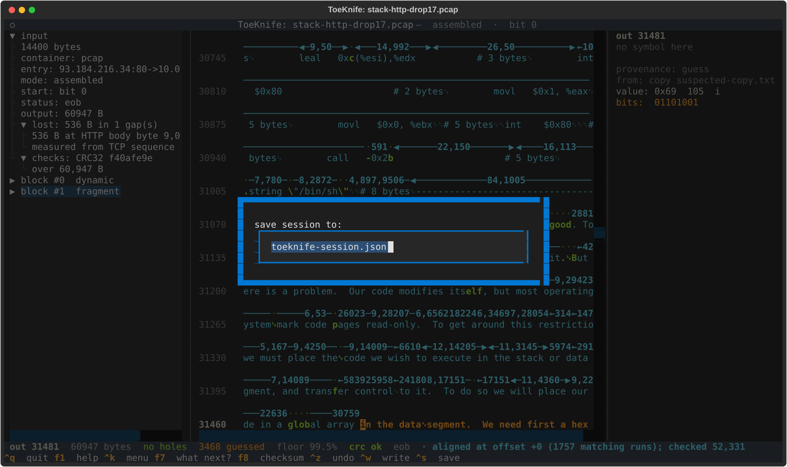
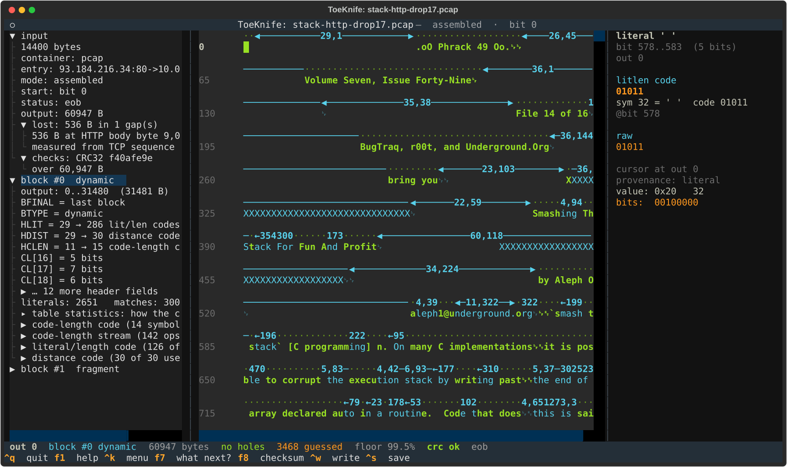

# Sessions and evidence

A session is everything you did to a capture: the repairs, the start you
chose, every byte you or a model or a copy put in, and the record of what
ran. `^s` saves it, and opening the capture again with `--session` puts it
all back, checked. `^w` writes the recovered bytes. `--why` and the ledger
say where any byte came from.

The examples use [Workflow B](b-lost-packet.md): `stack-http-drop17.pcap`
with its lost packet filled from `suspected-copy.txt`.

## Saving

`^s`:



The file is JSON. What it holds:

- the input's SHA-256, taken before any repair;
- the steps that changed the input or the decode, in order: a start bit
  you chose, a resync, a flipped-bit repair, reading on past damage, a
  borrowed table;
- every byte put into a hole, with who put it there (you, the checksum, a
  model) and, for a copy or a dictionary, which file;
- the ledger;
- a SHA-256 of the whole tape as saved.

This one is 116 KB, almost all of it the copy's 3,468 bytes and their
provenance. From the command line, `--save-session FILE` saves after
everything else on the line has run:

```
toeknife stack-http-drop17.pcap --fill-from suspected-copy.txt --save-session stack-http.session --verify
```

## Opening it again

Give the same input, and the same options that chose the stream
(`--entry`, `--gap`), with `--session`:

```
toeknife stack-http-drop17.pcap --session stack-http.session
```

```
session: 0 step(s) replayed, 3,468 byte(s) put back, 0 class(es) open; the tape matches the one saved
```



The steps run again in order, the bytes go back on, and the tape that
results has to hash to what was saved. Any of three things stops the
load and says which:

- **A different input.** `session file was saved against a different
  input: its SHA-256 differs`. A file of the same size with one byte
  changed is a different input.
- **A step that will not run.** `step 2 of the session (resume) did not
  replay`, with the reason.
- **A different tape.** `the session replayed to a different tape than
  the one saved`. Something in the input or the tool changed since.

The session goes on first. Options on the same command line apply on top
of it, so `--session s.json --fill-from other.txt` tries another copy
against the saved state.

Session files from before the replay log (version 3) still open. They
hold a start bit and the bytes, nothing else.

## Writing the result

`^w`, or `--export FILE` on the command line, writes the recovered bytes:

```
wrote 60947 bytes to stack.txt (60947 known, 0 filled with '?'); first byte is output position 0
```

Each unknown byte is written as `?`; `--fill CH` picks another character.
What goes in front depends on the stream:

- **A carve** ([Workflow A](a-carved-fragment.md)) writes the window
  before its first decoded byte too, so the first byte of the file is
  output position -437, not 0, and the message says so.
- **A stream with a preset dictionary** ([Workflow H](h-missing-dictionary.md))
  writes its output alone; the dictionary is not part of it.
- **One member of a multi-member gzip** ([Workflow G](g-bad-gzip-member.md))
  asks: this member, or the whole file joined as gunzip would.
- **A repaired PNG** ([Workflow I](i-inside-other-formats.md)) asks: the
  decoded bytes, or the input file with the repair applied.

A file written with `?` in it records your best state of knowledge. The
checksum line from `f8` is what says whether it is the original.

## Where a byte came from

The side pane gives the byte under the cursor: its provenance, and for a
hole, every position in its class. `--why POS` follows the whole chain:

```
toeknife stack-http-drop17.pcap --session stack-http.session --why 9000
```

```
out 9000: copied through 2 hop(s) from out 2094, which is literal

    out 9000      63  copy     [copy]
        copies 15 byte(s) from 20 back
 <- out 8980      63  copy     [copy]
        copies 4 byte(s) from 6886 back
 <- out 2094      63  literal  [literal]
        literal at bit 8843
```

Byte 9000 is `c` (63), copied from 20 bytes back, which was copied from
6,886 back, which is a literal at bit 8,843 of the stream. That literal is
read from the capture, so byte 9000 is a fact. A chain that ends in a
byte you put in says so, and names the file it came from:

```
out 33215: put in from copy suspected-copy.txt, not read from the stream

    out 33215     30  guess    [guess]

  This byte is only as good as out 33215, which came from copy suspected-copy.txt.
  Change that one and this byte changes with it.
```

The side pane shows the same `from:` line for the byte under the cursor.
A byte you typed has no file to name and says `set by a guess`.

The colours on the tape are the same information at a glance;
[Concepts](concepts.md#colours) lists them.

## The ledger

Every route you run, and every refusal, is recorded with what it found.
It sits at the bottom of `f7`, travels in the session, and prints with
`--ledger`:

```
toeknife stack-http-drop17.pcap --session stack-http.session --ledger
```

```
What has been run, in order:

  1. copy: found  aligned at offset +0 (1757 matching runs); checked 52,331 decoded bytes, 0 contradicted; filled 3,468 classes (8,616 positions). The checksum agrees: the missing bytes were exactly this copy's  filled 3,468, contradicted 0  (path=suspected-copy.txt)
```

The bytes name the copy; the ledger adds what the CRC said about it. A route that declined to rule is recorded as
declining, which is a different answer from one that ran and found
nothing.
